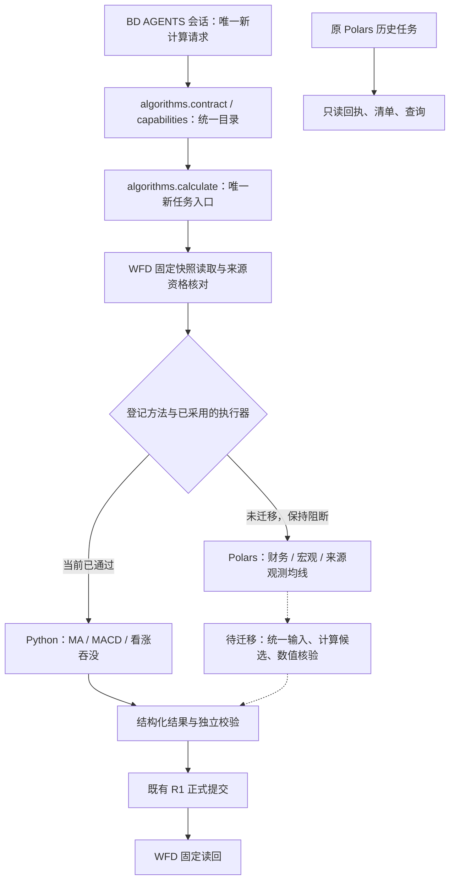

# BD 基础金融算法统一：第一阶段（入口、方法目录、迁移门禁）

## 冻结裁决

**固定算法**是计算方法性质；**本地算法**是执行位置。二者不应该在 Archify（架构图）中作为两条独立业务路线。WFD（金融数据仓库）正式发布的计算应由 BD AGENTS（会话代理）明确启动，通过唯一动作 `algorithms.calculate`（算法计算入口）创建新任务，方法合同决定使用 Python（本机算法执行器）或 Polars（本机结构化计算执行器），不得由模型临时覆盖执行引擎，也不得重开原报自动算法。

本阶段只完成**方法目录与新任务入口收敛**，没有声称 Polars 方法已完成统一计算、独立核验与正式发布。旧历史任务仍可读取，不向旧方法强行伪造新任务身份。

## 实际源码改动

| 位置 | 行为变化 | 对外兼容影响 |
|---|---|---|
| `modules/financial/basic-algorithm-tool-contract.ts`（统一算法方法契约） | 从现有 `FIXED_CALCULATION_METHODS`（旧 Polars 固定方法表）读取财务、宏观和观测 MA20 的原登记，按 `financial_linear`（财务单季/近十二个月）、`macro_yoy`（宏观同比）、`source_observation_ma`（来源观测均线）并入 `algorithms.contract`（统一算法目录）。旧 `observation_ma20` 仅作为历史别名，不形成第二个新计算方法。 | 新目录完整但迁移方法一律 `blocked`（不可执行），避免冒充已验收 |
| `modules/financial/conversation-algorithms.ts`（算法会话桥） | `algorithms.capabilities`（算法能力发现）附带统一 `methodDirectory`（方法目录），仍从真实算法服务读取已启用方法，不自行发起计算 | 已准备的方法继续按照原合同执行 |
| `modules/financial/algorithm-service.ts`（既有 Python 算法服务） | `algorithms.calculate`（统一新任务入口）遇到未迁移的 Polars 方法时返回 `ALGORITHM_METHOD_NOT_MIGRATED`（方法尚未完成统一迁移）；在建任务、读 WFD 或运算前拒绝。未知方法仍返回 `INVALID_ALGORITHM_METHOD`（非法方法）。 | 不会因为旧方法已列目录就错误创建候选计算任务 |
| `modules/collection/fixed-calculation-service.ts`（旧固定计算服务） | `create`（新建旧 Polars 计算任务）明确拒绝并返回 `ALGORITHM_UNIFIED_ENTRY_ONLY`（只能使用统一入口）；`capabilities.configured=false`（旧入口不再允许新算）。 | `list/get/records/inputs`（历史任务、固定快照查询）保留；不会删除已存任务或候选 |

**尚未改变：** 原 Python `ma`（移动均线）、`macd`（指数平滑异同均线）、`bullish_engulfing`（严格看涨吞没）及原 WFD（金融数据仓库）固定快照读取、原独立核验与 `DerivedWfdPublisher`（派生发布器）保持原样。旧 Polars 公式源码未删除。

## 统一业务线路

`G` 到 `H` 的虚线代表**未实现**，不能在 Archify 总图画成已连通。

## 第二阶段迁移工作（仍未完成）

1. 给 `financial_linear`（财务固定计算）、`macro_yoy`（宏观同比）和 `source_observation_ma`（观测均线）分别接入原始 WFD 固定快照读取，冻结多个实际产品/记录版本、单位、财务期间、公布时间和历史资格。
2. 为方法登记一个固定的 `executor`（本地执行器）与实现摘要：允许复用旧 Polars 公式和既有金融语义校验，不能从客户端接收任意 Python 脚本/公式/引擎名。
3. 扩展 `checkDerivedForWfd`（派生结果独立核验）与 `DerivedWfdPublisher`（WFD 正式派生发布器）的**方法专属核验适配器**。它们目前只接收 MA/MACD/严格看涨吞没行情结构，不应把财务/宏观的原始 Polars 行强制塞进价格字段。
4. 逐项验收数值、单位、来源修订、历史可得、任务断点恢复及 WFD 已发布固定读回后，才把三种 Polars 方法由 `blocked`（不可执行）切到 `ready`（已验收可用）。
5. 历史任务只读兼容：旧 `bd.polars-fixed`（Polars 任务运行时）继续读已存结果，但不得静默重算或覆盖。之后才能删除已确认无引用的旧入口代码。

## 验收门禁

- `modules/financial/unified-algorithm-entry.test.ts`（统一入口测试）检查方法无重复、旧别名不新建任务、迁移方法确实不可执行、旧固定入口拒绝新任务且旧结果可读。
- `modules/financial/basic-algorithm-tool-contract.test.ts`（既有算法目录契约测试）不能放宽 WFD 冻结输入和 AGENTS 主动性边界。
- TypeScript（静态类型检查）和生产构建必须通过。
- **严禁**以禁止新任务冒充完成 Polars 算法迁移；正式 WFD/历史库真实验收另计。
