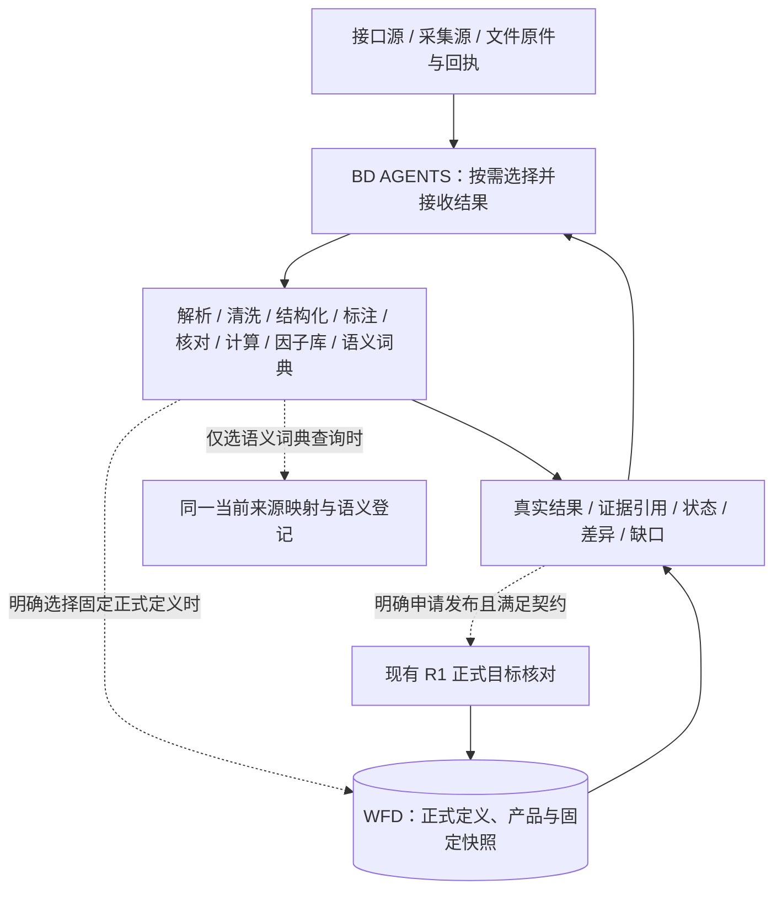

# 接口来源语义补充与跨来源核对

## 当前实施优先级

**先补框架，再深化精度规则。** 统一使用“语义词典”名称，复用 `data.modules.semantics` 稳定工具标识。原机器协议字符串继续可读，改显示名称不迁移 WFD 或复制兼容入口。

本轮补齐模块能力发现、语义词典查询模式、请求适用条件、差异与缺口反馈。暂缓新增 `precision/scale/rounding` 及其专项计算、发布和验收实现。原有十进制字符串处理、非法值拒绝、独立核验及不静默降精度的安全检查保持不变；不会以“暂缓精度”为由改用浮点强转。

## 一条主线，不重复建立语义数据库

**来源接口及采集** → **端点适配**（协议、字段位置及有依据的单位转换）→ **既有按需处理模块** → **R1/WFD 正式准入、发布与固定读回**。各模块先返回 AGENTS，不自动触发下一模块。

**语义词典是八个并列工具之一。** 它复用 R1 的 `SourceFieldProfileStore`、`SemanticProductRegistryStore`、语义模板及 WFD 已发布产品声明。来源映射仍由受信运行根保管；查询能力不授予 AGENTS 修改配置、采用新定义或发布数据的权限。没有平行语义服务，也不是原件必须经过的额外工序。



数据类型、市场和供应商不绑定固定加工模块。载体决定适用解析器，语义证据决定字段映射是否适用，AGENTS 根据实际结果选择后续模块。`data.adapters.replay` 只核来源解析、声明类型与有据单位换算，不调用清洗或正式发布。适配器测试通过不等于整条 BD/WFD 管路通过。

## 来源接口与字段档案

新任务以稳定 `adapterId` 选择当前已采用实现，任务内部冻结 `adapterId + version + configDigest`。冻结内容包含载体、端点、请求字段顺序、频率、复权和市场条件。真实请求回执与配置不一致时保留缺口或拒绝，不以模型声明覆盖原始回执。

实际来源档案位于 `<运行根>/config/source-fields/*.json`，同一来源/系列只保留一份当前映射。仓库的 `config/source-field-profile.example.json` 仅为合成格式模板。档案记录来源身份、数据系列、原表头和别名、规范字段、类型、单位、角色、计量口径、频率、时间桶、复权依据与操作者确认。字段或别名重复映射明确拒绝。

新配置不要求 `mappingVersion`、`adapter` 或 `supersedes` 历史链。已有任务读取其冻结映射；更换来源实现但金融含义未变，不创建另一套金融产品。单位、复权或计量含义真正改变时，核实后修订当前映射，正式定义演进仍交给 R1/WFD。

`semantic-products.json` 只登记规范语义指纹到数据集的映射约束，不授予 WFD 产品权限，也不自动合并历史产品。程序不自动删除用户来源配置或正式数据。

### 统一来源候选结果（已接入当前接口源）

继续使用 `sourceOperations`（唯一操作目录）和 `SourceSettingsService.operationCandidates`（现有主备选择）；不复制供应商路由，也不新增独立任务入口。实际 `source.kline.read` 与 `source.api.read` 成功取得原件后，在既有下载回执及 AGENTS 有界预览里补充 `candidateFeedback`：

- `logicalRequest`：市场范围、操作类型及在受控日线确实声明过的证券、时间和复权条件；不含供应商实现版本。
- `actualSource` 与 `evidence.originalRefs`：实际使用的供应商/连接以及已保管原件引用与 SHA-256；不把两个来源的证据合并。
- `observation`：`rows_observed`（实际解码到记录）、`empty_unconfirmed`（解析为零行但未证明真空）、`raw_only`（仅有原响应）。后两者不能冒充“确认无数据”或“已支持完整历史”。
- `coverage`：仅保留实际解码的起止区间，`completeness: not_established`；交易日覆盖、停牌、供应商历史可用范围仍待独立核实。
- `semanticStatus: not_verified`、`gaps`、`next: return_to_agents` 与 `publication: not_requested`：每次结果交回 AGENTS，按需查语义词典或处理模块；来源下载不会自动发起 WFD 发布。

限流、无权限、失败及不支持历史范围仍依靠原动作的受控错误返回；暂未在所有来源统一为六态结果信封，不能因本次新增字段宣称完整来源覆盖治理已经完成。

## 语义词典的独立查询模式

稳定入口仍为 `data.modules.semantics`，每次只选择一种模式：

| 模式 | 参数 | 读取范围 |
| --- | --- | --- |
| 模板查询 | `groupId`，可省略以列出模板 | 只读参考模板，不冒充已采用定义 |
| 来源查询与跨来源比较 | `sourceQueryJson` | 只查当前来源档案、登记及声明条件 |
| 正式定义查询 | `wfdRefJson` | 只查指定 WFD 快照中的产品定义 |

能力目录分别公开各模式是否可用；某一种模式未装配，不暗中切换到另一种。来源查询不先读取模板；正式定义查询不附带读取数据值页。需要值数据时另外调用既有 WFD 读取入口。

所有词典结果返回 `displayName: 语义词典`、`returnTo: agents`、`execution: not_requested`、`publication: not_requested`、`adoption: not_granted`。来源结果保留档案、规范指纹、差异和证据缺口；正式定义结果保留快照和产品身份；参考模板始终标明其非正式权威性质。

### 请求适用条件

`sourceQueryJson` 接受 `left`、可选 `right`、`fieldCode` 和 `conditions`：

```json
{
  "left": { "sourceId": "provider-a", "series": "daily.price" },
  "right": { "sourceId": "provider-b", "series": "daily.price" },
  "conditions": {
    "frequency": "day",
    "adjustment": "raw",
    "timezone": "Asia/Shanghai",
    "fieldUnits": { "close": "cny_per_share" }
  }
}
```

条件还可明确 `adjustmentMethod` 和 `adjustmentBasis`。这些是调用方所需口径，不是模型提交的新档案或授权。相同条件可比较不同来源；切换适配器实现不要求更换请求结构。`fieldCode` 只筛选显示字段，不能缩小内部语义核对范围。

`applicability` 独立返回 `applicable`、`incompatible`、`needs_evidence` 或 `not_requested`，区分已知不匹配与证据不足。两个来源互相相同但都不符合本次请求时，不得返回可用等价结论。缺少参数时不自动补默认复权、币种或时区。该检查目前只覆盖来源档案已声明的口径，不冒充对象历史覆盖、真实账号权限或正式发布门禁。

### 语义结果与准入边界

`compareProfileSemantics` 和语义词典共用 `profileSemanticGaps`，不维护两份缺口规则：

| 状态 | 含义 |
| --- | --- |
| `candidate_equivalent` | 当前比较及请求条件范围内候选相同，尚不等于同一正式产品 |
| `different_semantics` | 存在已明确语义差异或不符合请求条件 |
| `needs_evidence` | 缺少足够依据，不把两个未知值当成相同 |

`identicalSignature` 仅表示指纹相同。前/后复权都未声明方法或基准时，相同标签不证明金融等价。单来源 `registered` 只表示档案存在，`semanticStatus` 和 `applicability` 另列证据与适用性。

确认/登记元数据要求显式有效 UTC 时刻，时间桶要求有效时区；这不是完整历史四时态实现，不将来源业务日期补成午夜发布时间。

## 框架补充顺序

先补稳定来源请求与结果信封，再补模块结果和异常状态、语义词典适用条件、R1/WFD 发布读取连接，最后补必要目录与影响查询。复用现有任务服务、来源插件、共享契约和正式发布器，不新增平行运行时或固定六步流程。

分页状态、原请求恢复和已接入官方响应的单页适配已有定向验证；尚未接入的生产来源续页、实际覆盖日历、领域规则、完整四时态和影响查询继续明确列为未完成项。精度深化在框架接线与对应实际管路完成后独立实施，不写成已实现能力，不为占位接口返回成功。

## 质量反馈与定向修订

原处理计划查询的 `quality` 由已保存的计划、步骤、输出缺口和产物完整性派生，契约在 `contracts/processing-quality.ts`，判断集中在 `modules/collection/processing-quality.ts`。不另存异常账本，不增加处理入口。会话反馈只附有界摘要，完整问题仍从原计划查询。

反馈区分执行失败、依赖阻断、产物或记录缺失、语义失败、待补证据及操作者拒绝。行列位置仅采用既有结构化位置；错误文字出现数字也不推断行号。失败范围沿明确 `dependsOn` 关系传播；同一原件、模块名称或相邻输出不构成依赖。缺证据或目标要求补充依据，不建议盲目重复清洗。

保留产物是复用候选，修订时仍由原服务核对输入、规格和实际产物摘要。`no_reported_issue` 仅说明当前记录没有报告问题，不证明完整金融质量通过，也不授予 WFD 发布权限。查询不触发修订、恢复、重跑或发布。

同一计划请求重发时，沿首次受理记录的证据观察时间重新核对本次输入，不将新的 HTTP 到达时间当作业务变化。原件、规则、声明、操作者和会话分支仍须匹配；会话证据继续由本次受信核对函数校验，旧计划与证据不重写。

## 声明发布集合与固定读回

WFD `data_only.submit` 继续用 `consistency_groups` 声明有相容依赖的输出集合；组内失败阻止该组发布，无关输出仍可独立发布。原 `expected_parent_snapshot_id` 校验目录基线，W06 发布器沿单一目录 HEAD 激活，提交与重试复用原请求身份。跨产品读回使用回执的同一个 `snapshot_id`，不分别读取各产品最新值再拼接。

卷发布回执须保留同请求中未发布输出的身份和原因码。独立输出发布成功时，失败组仍须在初次回执、原身份重试和重开状态查询中显示为未发布，总体为部分发布；这些信息复用现有发布意图和正式回执，不新增数据库或逐行台账。原始执行报错文字及本机路径不写入正式卷。

BD Web 已接通独立输出确认和已声明集合的整组准备、人工确认、提交及逐成员固定读回。集合成员来自冻结计划，不能以循环单输出提交代替整组约束；不把整个计划或任意跨组依赖自动并为一个事务。磁盘满、突然断电及 exFAT 硬件持久性需另外现场验收。固定算法的数学语义和实现身份按下述边界分开，财报及历史领域扩展仍是后续范围。

## 验证与维护

`test:pipeline` 复用来源语义、模块框架、质量异常与 HTTP 重开修订、重复入库、端点处理以及真实 R1/WFD 发布固定读回测试。现有仓库 CI 的 WFD 定向检查同时运行 `test_publication_sets.py`，覆盖声明发布集合、重试和固定读回。会话桥的替身测试只证明模式隔离与调用边界，不冒充真实模型、供应商或现场账号验收。

保留既有 WFD 产品、Snapshot、语义指纹及稳定动作名称。仅普通代码或显示名变化，不重写历史金融身份。验证记录只写本轮实际变更、结果和未覆盖项，不复制旧通道、全量快照或多套验收报告。


## 已声明发布集合的 Web 接线

加工计划可通过 `consistencyGroups: {集合编号: [outputId, ...]}` 明确登记互不交叠的关联集合。
成员随原计划冻结，不决定解析/清洗阶段，也不绑定来源实现版本；变更成员必须修订计划。
Web 沿用 `/r1/prepare`，只传 `kind: publication_set`、原计划、集合编号与请求编号，不接受调用方拼接行、目标或成员子集。
受信服务从现有计划和实际产物逐成员核对同一数据集/父快照、来源授权、语义、产物摘要和依赖闭合。

准备形成一个实际 structured-ingest 文档和一个原请求身份，复用 WFD `consistency_groups` 发布器；
整组人工确认绑定全体成员、连接与单一文档摘要。首次发送前再核当前 WFD 用途限制。
当前整组边界为总计 5,000 行、786,432 字节和最多 16 个成员，采用成员冲突整组拒绝，不把逐行跳过当作组原子性。
独立单输出继续保留原有重复录入策略。源声明不齐、不同父快照、跨集合依赖或缺少成员时明确阻断。

实际回执须与原文档成员一一对应；同组只有全体发布或全体失败，已发布成员必须使用同一快照。
现有固定读回器按成员验证真实行身份、业务值与合同，全部验证完成后才在一次本地事务写入逐来源关联。
分页检查点仍使用原表，以原请求和成员键派生本地检查点身份；不新建 WFD 请求或平行发布任务。
回执丢失只沿原身份查询，失败成员和原因码在重开后仍显示。准备、查询、刷新与确认是不同动作，均不自动串联。

测试使用隔离合成参数和实际 HTTP/TaskService/WFD 执行器；不是实际 exFAT 设备或断电耐久性结论。
Linux 全回归与精度深化继续后置。此次没有新增数据库、运行时或发布器。


## 固定算法的数学语义和执行实现

当前仍只登记固定 MACD，不新增算法运行时或发布器。`algorithm-types.ts` 的 `MACD_SEMANTICS` 是数学合同：12/26/9、首条有效收盘价初始化、2 倍柱值、完整所供窗口、不填缺失、不接续旧状态及输出单位随已核对输入。`methodVersion` 表示数学定义版本；`implementationVersion` 是本次真实 Python 资产摘要，保留在 BD 原任务、结果和独立核验证据中。目录不再把数学版本显示成实现版本。

新派生准备的 `algorithm_definition.definition_version` 仅由数学方法版本及语义合同派生，不包含实现摘要、任务号、取得时间或 UI 文案。换实现但数学含义和结果相同时，正式定义、业务键及数据值保持相同，由既有 `skip_identical_append` 核对同值重复，不新增金融事实或快照；原任务与各次执行证据仍可区分。数学版本、初始化、输入口径或数值发生变化时仍拒绝或进入正式冲突/更正，不能靠“只是实现升级”放行。

已存在的 R1 请求保持原文档和摘要。读取历史实现绑定定义时，只允许从原 R1 持久请求读取冻结文档，核对原数学版本、实现身份、全部输入/目标/值及最终文档摘要后按原身份恢复；不执行旧源码，不对新准备开放旧写入入口。损坏文档不是未配置，结果未知只查询原请求。已发布产品及 Snapshot 不批量重写，也不自动把旧实现绑定产品与新语义身份合并；存在旧正式定义冲突时仍由现有 WFD 定义采用/演进边界处理。

验证使用原有 `macd-full-chain.test.ts`：保留 80 行实际 Agents→Python→WFD 固定读回，再用独立的 12 行隔离样本替换真实 Python 实现文件，仅改变注释与资产摘要；要求数值、正式定义和记录版本不变，重复新增为零，删除测试旧实现资产后原结果与固定读回仍可读。历史冻结请求、改公式/初始化、改业务值与改输入口径分别验证。不增加字段级精度规则，不默认启动 Linux 全量回归。


## 历史读取与实例可用阶段

原 `/r1/products/read` 继续固定 `snapshotId`、真实 `productId`、投影及游标。缺省保持 `snapshot_contents`；历史请求显式选择 `historyMode: market_known_at` 或 `system_held_at`，并提供秒级 UTC `at`。系统视角还必须明确 `heldScope` 及 `usableStage: acquired | custodied | published_readable`。日期、无时区、无效日历和未支持的精度不自动补齐；现有固定快照请求不变，也不新增同义历史端口。

先核所选产品真实读合同支持该视角，再由已有 WFD 历史选择器执行。BD 核对实际返回的快照、产品、视角、截止、实例范围、阶段与原游标。游标不能跨截止、视角或持有阶段复用；新 HEAD 和重开宿主不改变已固定选择。来源公开时间未知或只有日期时，保留现有三态判定及 diagnostics；`complete: false` 的部分记录不是完整历史，零行不等于来源确认无数据。

算法固定输入同样核对返回的实例范围与逐行阶段，并保留真实 `held_at`。`published_readable` 的时间不能从请求截止、公开时间或 acquired 时刻代填。存在不确定版本诊断时，历史计算拒绝采用部分输入，不退回 latest，也不自动重算或发布。

**撤销公告时间独立于原行。** `outputs[].revisions[logical_key].withdrawal_public_time` 可显式提供 WFD 时间精度对象；仅撤销允许此字段，非法日历/空或倒置区间拒绝。撤销仍须引用未改写的前驱行，时间进入不可变版本元数据，不改写前驱 `public_time`、旧正式数据或快照。市场历史先判定撤销公告区间资格，再做版本选择；公告前仍读前驱、公告明确可得后读撤销诊断。未提供/未知时间或日期精度覆盖截止点时保留缺口，R1 拒绝 `R1_READ_REVISION_TIME_UNSUPPORTED`，算法拒绝不完整历史，不能降级 latest。系统持有视角和固定快照按原规则工作。此增量不补造披露证据，不表示定义/实体映射的历史相容性或财报相容输入完成，后两项仍须随后独立核对。

`r1-history-read.test.ts` 使用实际 HTTP、绑定的 R1/WFD 和算法固定输入端口，验证原报、更正、晚到、日期与未知时间、系统阶段、重开、101 行分页和冻结快照。持有时刻通过 WFD 已有 `record_test_fixture` 及显式 test-mode 注入，只位于独立测试卷，不是生产时钟或用户设备证据。普通查询不调用该测试入口。Linux 全回归和字段级精度规则继续后置。


**历史定义投影边界（R1）。** 同一产品允许兼容新增字段，但新增字段不能替代旧行的固定合同。历史查询若收到 `FIELD_NOT_DEFINED_IN_ROW_CONTRACT` 或 `PRODUCT_CONTRACT_UNAVAILABLE`，R1 明确返回 `R1_READ_HISTORY_METADATA_UNSUPPORTED`，不将缺失投影作为普通成功结果返回；调用方可显式选旧版本已有字段继续固定读取。WFD 原有逐行诊断保留，快照内容查询不改，未新建定义历史引擎。此项只验证固定行绑定与投影相容性，不宣称定义或实体映射具有独立的市场公开时态。


**定义独立公开时间与保守拒绝。** data_only 输出可显式提供 `definition_public_time`，
使用既有时间精度契约校验，并与该输出的确切定义/合同一同冻结在正式文件绑定中。
不把时间加入金融定义身份，不从行公开时间、取得时间或当前登记回填，也不改写旧快照。
同值去重不能静默改变定义时间证据；同批冲突或与已保存绑定不符时要求明确修订。

市场历史查询要求所选产品的固定快照绑定均有已满足截止的定义时间。
缺失、未知、日期区间跨截止或明确在未来时，当前实现保守拒绝整个产品查询，
R1 返回 `R1_READ_HISTORY_METADATA_UNSUPPORTED`。这不是自动选择旧定义的完整历史引擎；
调用方仍可明确固定更早快照，或用满足全部定义时间的截止读取。旧无时间数据仍能固定快照读取，
系统持有视角继续按实际持有阶段与固定行合同判定，不拿市场公开时间替代实际持有。
历史产品结果只附合格行对应的合同，不能借诊断或整快照目录附出未来新增字段定义。

实体映射继续使用既有 `relation_edges` 的独立 `public_time` 与 `effective_period`。
历史可知不等于关系已生效；关系图须同时使用明确的业务有效期范围，未知有效期不能作为确认连接遍历。
实际 data_only 关系/规则/事件测试覆盖未来关系、未知有效期、历史规则与跨进程游标。
本轮没有新增实体映射数据库、自动修订旧证据、历史选择器界面或单季/TTM算法。
