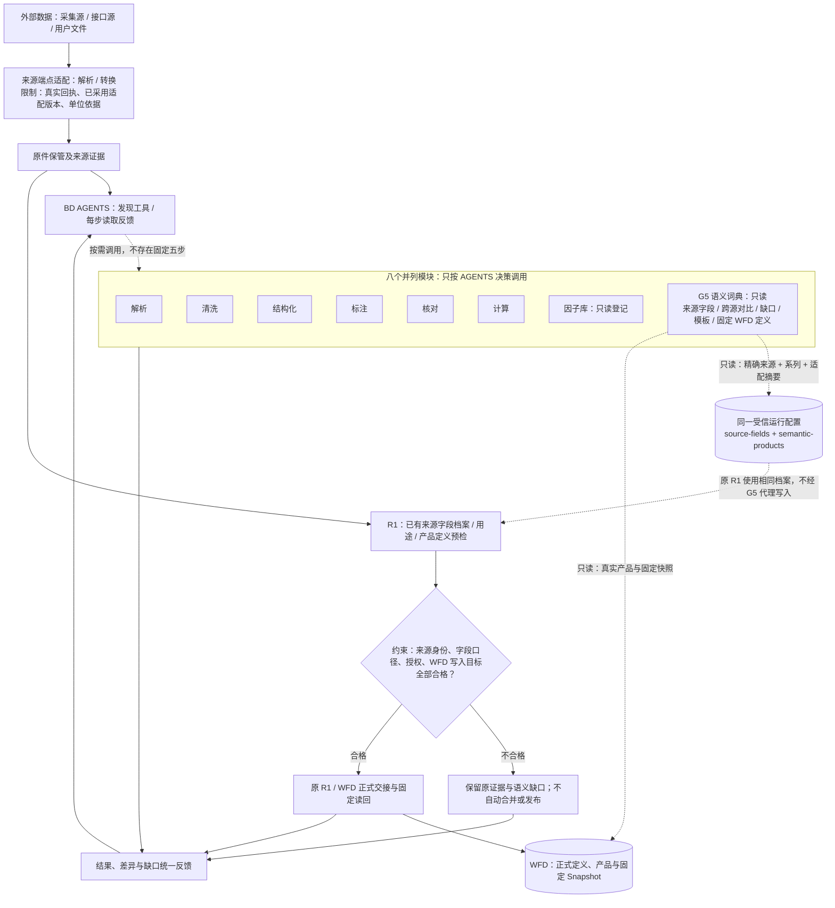

# 接口来源语义补充与跨来源核对

## 一条主线，不重复建立语义数据库

**来源接口及采集** → **端点适配**（`endpoint-adapter`，读取结构、字段序号及有依据的单位转换）→ **R1 原报预检**（`r1-auto`，复用来源字段档案，核对证据与已有定义）→ **WFD**（正式定义与 Snapshot 固定快照）。

**G5 统一语义词典是八个并列工具之一**。它通过 `data.modules.semantics`（AGENTS 的语义词典只读动作）按需读取与 R1 *同一个* `SourceFieldProfileStore`（来源字段档案服务）、`SemanticProductRegistryStore`（语义产品登记服务）、语义模板和已发布 WFD 产品声明，并使用 `compareProfileSemantics`（跨来源规范语义比较）报告差异。来源映射配置仍由本机受信运行根保管；查询能力并不意味着 AGENTS 可直接修改配置、采用新定义或绕过 WFD 正式准入。**G5 不是原报必须经过的额外加工步骤**，不存在来源管道里的平行 G3 语义服务。

## G5 与八个并列模块的当前接线（Mermaid 源图）

注意：G5 的 `compareProfileSemantics`（来源语义比较）是**按需查询能力**，并非全部 R1 请求的自动强制跨供应商比较门禁；R1 已有自己的来源档案选择、原件证据和 WFD 定义预检。图中虚线表示只读依赖，不是自动触发。

## 发现字段差异

### 1. 接口结构与返回字段

一份端点适配配置使用 `adapterId + version + configDigest`（适配器编号、明确版本、实际配置摘要）锁定：
- `match.endpoint`：端点身份
- `match.protocol`：协议/载体版本
- `match.fields / fields2`：实际请求字段及原顺序
- `match.frequency / adjustment / market`：频率、复权及市场
- `fields[].unit`：有出处的源单位、目标单位及精确换算系数

源请求的 URL、文件字节摘要与已采用配置不匹配，不以声明覆盖原回执。候选适配器由现有 `data.adapters.propose / replay`（提案/样本重放）记录；受信本机操作者通过正反样本证据确认后才采用，模型没有采用权限。

### 2. 供应商字段意义

仓库中的 [`config/source-field-profile.example.json`](../config/source-field-profile.example.json) 是**合成模板**，不是供应商可直接使用的实配置。

实际档案由受信运行根的 `<运行根>/config/source-fields/*.json` 保存；一个文件一份历史映射，不存密码与原始用户数据。新增档案需要：
1. 真实 `sourceId`（来源身份）与稳定 `series`（接口数据系列），不得使用交易日/证券代码充当系列身份
2. 若源数据由已采用端点适配器产生，填写其**真实** `adapter` 三元组；不填写或错误摘要不会被自动套用到该端点
3. 逐字段填写原表头、仅本来源有效的 `aliases`（别名）、规范字段码、类型、单位、角色以及值字段的 `measurement`（金融计量口径）
4. 频率、时间桶定义、复权状态；后复权/前复权方法与基准有定义时分别保留
5. `confirmation`（操作者确认时间和具体依据），必须指向实际接口文档或保管样本；填“已确认”四个字不是证据

相同来源的两个端点应有**不同的适配器绑定**；若已采用端点有新的字段顺序、复权或定义，按新的适配摘要/版本建立映射。旧的无 `adapter` 档案只能用于没有端点适配引用的原始材料，绝不覆盖已选择的端点定义。

原件里一个字段的别名与规范表头若同时出现，按重复映射拒绝；不用哪个先出现就选哪个。档案若与端点适配器的实际有效类型、单位、频率或复权状态冲突，拒绝当作同一业务口径。

## 语义补充与版本治理

| 差异 | 补到哪里 | 自动采用？ |
| --- | --- | --- |
| 原表头/别名、时间格式、字段位置 | 该接口端点配置或该来源字段档案 | 否，需按冻结配置重放 |
| 可证明的手/股、元/万元换算 | 端点适配器的单位转换依据；保留原始值 | 只有已采用配置允许确定性换算 |
| 同名但频率、复权方法/基准、增量/累计、计量对象不同 | 来源字段档案的明确语义描述；正式数据形成不同 WFD 定义或修订 | 否 |
| 新的金融指标、规范单位、修订的产品口径 | WFD 正式语义定义及其历史版本；原件证据由 BD 保存 | 走 R1/WFD 现有独立准入 |
| 确定性计算方法与金融因子 | 原算法目录/实现/核对与派生产品合同 | 不能因语义登记就自动可执行 |

**历史升级**：在旧档案旁保留新的 JSON；提高 `mappingVersion`，填写新的 `profileId` 和 `supersedes:[{profileId,note}]`，并提供新的 `confirmation` 依据。同一来源、系列和同一端点绑定下，多个版本只接受连续且明确的替代链。缺关系、同版本碰撞、多个当前候选都拒绝挑选。旧任务保留其原档案摘要，新任务才使用新的受控版本。

**跨来源认同**：`compareProfileSemantics`（来源语义比较）比较规范字段的类型、单位、角色、计量口径，比较频率、时间桶、复权状态、复权方法与基准。只知道列名或单位、但值的金融计量含义未知，不认定两家供应商的数据可合并。标准化后可独立比较，不改写来源原件。

若运营者已经明确登记同义语义对应哪个数据集，可以在实际运行根 `<运行根>/config/semantic-products.json` 中登记 `profileFingerprint`（规范语义签名的内容摘要）到 `datasetId`（正式数据集编号）的关系。仓库 [`config/semantic-products.example.json`](../config/semantic-products.example.json) 只是格式模板，其全零指纹不代表真实数据。登记只有**映射约束**，不是 WFD 产品授权，也不自动把不同来源的历史产品合并。

## G5 的只读工具参数与约束

`data.modules.semantics`（语义词典工具）原有 `groupId`（模板分组）和 `wfdRefJson`（WFD 固定产品只读引用）保持兼容。新增可选的 `sourceQueryJson`（来源语义查询 JSON），仅在 G5 内使用：

- 单来源查询：`{"left":{"sourceId":"synthetic-a","series":"daily-kline","adapter":{"adapterId":"synthetic.daily","version":"1","configDigest":"<64位实际摘要>"}}}`；其中摘要必须来自已采用配置，不能从示例中的占位字符推断有效
- 跨来源比较：增加 `"right"`（第二个来源身份），可选 `"fieldCode"`（只筛选可见预览字段；内部比较始终覆盖完整档案）
- 输出：`status`（查询状态）、`digest/fingerprint`（完整来源档案内容摘要/规范语义指纹）、字段与来源口径**有界预览**、差异原因、`gaps`（待补证据）及本机登记的数据集编号（若存在）
- 与 `groupId`、`wfdRefJson` 或加工计划参数互斥；不会修改映射、远程注册或发布 WFD
- `candidate_equivalent`（来源签名候选等同）不代表 WFD 正式产品相同，需按固定合同和授权另行核对；`not_configured`（本机未装配）和 `needs_evidence`（缺依据）均不能说成通过

## 发现新知识时的处理

- 已有可靠口径和明确匹配：继续沿原 R1 流程，采用已确认字段档案和冻结的 WFD 定义
- 来源版本或字段超出已登记范围：保留原件、来源回执和未映射字段；回到候选解释/来源核对，不用相似名字推断
- WFD 存在同族定义但需要新增字段：R1 只允许真实合同所支持的加性演进；旧字段和旧身份不被覆盖
- 口径冲突：R1 返回 `R1_AUTO_DEFINITION_CONFLICT`（定义冲突），需新来源和修订证据；最终准入仍由 WFD 决定
- WFD 无对应正式定义：R1 依据有出处的原件生成定义候选并由 WFD 审核，不把静态模板冒充已发布产品

此流程不包含自动新增账号、定时采集、模型自我批准或新数据库。确认 `source-fields` 档案和 `semantic-products.json` 并不代表真实 WFD 连接已经配置；实际发布需单独验收。
