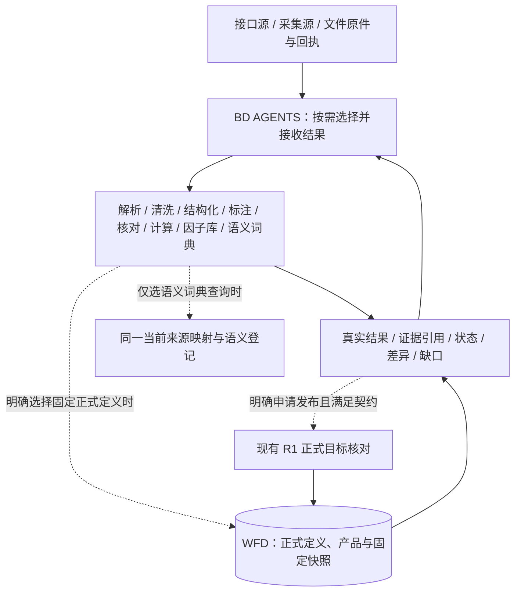

# 接口来源语义补充与跨来源核对

## 当前实施优先级

**先补框架，再深化精度规则。** 统一使用“语义词典”名称，复用 `data.modules.semantics` 稳定工具标识。原机器协议字符串继续可读，改显示名称不迁移 WFD 或复制兼容入口。

本轮补齐模块能力发现、语义词典查询模式、请求适用条件、差异与缺口反馈。暂缓新增 `precision/scale/rounding` 及其专项计算、发布和验收实现。原有十进制字符串处理、非法值拒绝、独立核验及不静默降精度的安全检查保持不变；不会以“暂缓精度”为由改用浮点强转。

## 一条主线，不重复建立语义数据库

**来源接口及采集** → **端点适配**（协议、字段位置及有依据的单位转换）→ **既有按需处理模块** → **R1/WFD 正式准入、发布与固定读回**。各模块先返回 AGENTS，不自动触发下一模块。

**语义词典是八个并列工具之一。** 它复用 R1 的 `SourceFieldProfileStore`、`SemanticProductRegistryStore`、语义模板及 WFD 已发布产品声明。来源映射仍由受信运行根保管；查询能力不授予 AGENTS 修改配置、采用新定义或发布数据的权限。没有平行语义服务，也不是原件必须经过的额外工序。



数据类型、市场和供应商不绑定固定加工模块。载体决定适用解析器，语义证据决定字段映射是否适用，AGENTS 根据实际结果选择后续模块。`data.adapters.replay` 只核来源解析、声明类型与有据单位换算，不调用清洗或正式发布。适配器测试通过不等于整条 BD/WFD 管路通过。

## 来源接口与字段档案

新任务以稳定 `adapterId` 选择当前已采用实现，任务内部冻结 `adapterId + version + configDigest`。冻结内容包含载体、端点、请求字段顺序、频率、复权和市场条件。真实请求回执与配置不一致时保留缺口或拒绝，不以模型声明覆盖原始回执。

实际来源档案位于 `<运行根>/config/source-fields/*.json`，同一来源/系列只保留一份当前映射。仓库的 `config/source-field-profile.example.json` 仅为合成格式模板。档案记录来源身份、数据系列、原表头和别名、规范字段、类型、单位、角色、计量口径、频率、时间桶、复权依据与操作者确认。字段或别名重复映射明确拒绝。

新配置不要求 `mappingVersion`、`adapter` 或 `supersedes` 历史链。已有任务读取其冻结映射；更换来源实现但金融含义未变，不创建另一套金融产品。单位、复权或计量含义真正改变时，核实后修订当前映射，正式定义演进仍交给 R1/WFD。

`semantic-products.json` 只登记规范语义指纹到数据集的映射约束，不授予 WFD 产品权限，也不自动合并历史产品。程序不自动删除用户来源配置或正式数据。

### 统一来源候选结果（已接入当前接口源）

继续使用 `sourceOperations`（唯一操作目录）和 `SourceSettingsService.operationCandidates`（现有主备选择）；不复制供应商路由，也不新增独立任务入口。实际 `source.kline.read` 与 `source.api.read` 成功取得原件后，在既有下载回执及 AGENTS 有界预览里补充 `candidateFeedback`：

- `logicalRequest`：市场范围、操作类型及在受控日线确实声明过的证券、时间和复权条件；不含供应商实现版本。
- `actualSource` 与 `evidence.originalRefs`：实际使用的供应商/连接以及已保管原件引用与 SHA-256；不把两个来源的证据合并。
- `observation`：`rows_observed`（实际解码到记录）、`empty_unconfirmed`（解析为零行但未证明真空）、`raw_only`（仅有原响应）。后两者不能冒充“确认无数据”或“已支持完整历史”。
- `coverage`：仅保留实际解码的起止区间，`completeness: not_established`；交易日覆盖、停牌、供应商历史可用范围仍待独立核实。
- `semanticStatus: not_verified`、`gaps`、`next: return_to_agents` 与 `publication: not_requested`：每次结果交回 AGENTS，按需查语义词典或处理模块；来源下载不会自动发起 WFD 发布。

限流、无权限、失败及不支持历史范围仍依靠原动作的受控错误返回；暂未在所有来源统一为六态结果信封，不能因本次新增字段宣称完整来源覆盖治理已经完成。

## 语义词典的独立查询模式

稳定入口仍为 `data.modules.semantics`，每次只选择一种模式：

| 模式 | 参数 | 读取范围 |
| --- | --- | --- |
| 模板查询 | `groupId`，可省略以列出模板 | 只读参考模板，不冒充已采用定义 |
| 来源查询与跨来源比较 | `sourceQueryJson` | 只查当前来源档案、登记及声明条件 |
| 正式定义查询 | `wfdRefJson` | 只查指定 WFD 快照中的产品定义 |

能力目录分别公开各模式是否可用；某一种模式未装配，不暗中切换到另一种。来源查询不先读取模板；正式定义查询不附带读取数据值页。需要值数据时另外调用既有 WFD 读取入口。

所有词典结果返回 `displayName: 语义词典`、`returnTo: agents`、`execution: not_requested`、`publication: not_requested`、`adoption: not_granted`。来源结果保留档案、规范指纹、差异和证据缺口；正式定义结果保留快照和产品身份；参考模板始终标明其非正式权威性质。

### 请求适用条件

`sourceQueryJson` 接受 `left`、可选 `right`、`fieldCode` 和 `conditions`：

```json
{
  "left": { "sourceId": "provider-a", "series": "daily.price" },
  "right": { "sourceId": "provider-b", "series": "daily.price" },
  "conditions": {
    "frequency": "day",
    "adjustment": "raw",
    "timezone": "Asia/Shanghai",
    "fieldUnits": { "close": "cny_per_share" }
  }
}
```

条件还可明确 `adjustmentMethod` 和 `adjustmentBasis`。这些是调用方所需口径，不是模型提交的新档案或授权。相同条件可比较不同来源；切换适配器实现不要求更换请求结构。`fieldCode` 只筛选显示字段，不能缩小内部语义核对范围。

`applicability` 独立返回 `applicable`、`incompatible`、`needs_evidence` 或 `not_requested`，区分已知不匹配与证据不足。两个来源互相相同但都不符合本次请求时，不得返回可用等价结论。缺少参数时不自动补默认复权、币种或时区。该检查目前只覆盖来源档案已声明的口径，不冒充对象历史覆盖、真实账号权限或正式发布门禁。

### 语义结果与准入边界

`compareProfileSemantics` 和语义词典共用 `profileSemanticGaps`，不维护两份缺口规则：

| 状态 | 含义 |
| --- | --- |
| `candidate_equivalent` | 当前比较及请求条件范围内候选相同，尚不等于同一正式产品 |
| `different_semantics` | 存在已明确语义差异或不符合请求条件 |
| `needs_evidence` | 缺少足够依据，不把两个未知值当成相同 |

`identicalSignature` 仅表示指纹相同。前/后复权都未声明方法或基准时，相同标签不证明金融等价。单来源 `registered` 只表示档案存在，`semanticStatus` 和 `applicability` 另列证据与适用性。

确认/登记元数据要求显式有效 UTC 时刻，时间桶要求有效时区；这不是完整历史四时态实现，不将来源业务日期补成午夜发布时间。

## 框架补充顺序

先补稳定来源请求与结果信封，再补模块结果和异常状态、语义词典适用条件、R1/WFD 发布读取连接，最后补必要目录与影响查询。复用现有任务服务、来源插件、共享契约和正式发布器，不新增平行运行时或固定六步流程。

未实现的来源覆盖、分页续取、业务规则、四时态和影响查询明确保留为未完成项。精度深化在框架接线与对应实际管路完成后独立实施，不写成已实现能力，不为占位接口返回成功。

## 验证与维护

`test:pipeline` 复用来源语义、模块框架、端点处理以及真实 R1/WFD 发布固定读回测试。会话桥的替身测试只证明模式隔离与调用边界，不冒充真实模型、供应商或现场账号验收。

保留既有 WFD 产品、Snapshot、语义指纹及稳定动作名称。仅普通代码或显示名变化，不重写历史金融身份。验证记录只写本轮实际变更、结果和未覆盖项，不复制旧通道、全量快照或多套验收报告。
