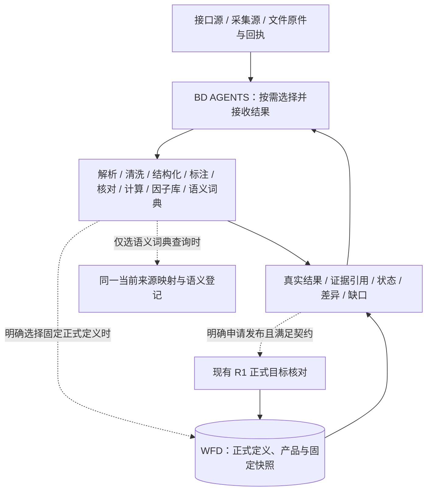

# 接口来源语义补充与跨来源核对

## 当前实施优先级

**先补框架，再深化精度规则。** 统一使用“语义词典”名称，复用 `data.modules.semantics` 稳定工具标识。原机器协议字符串继续可读，改显示名称不迁移 WFD 或复制兼容入口。

本轮补齐模块能力发现、语义词典查询模式、请求适用条件、差异与缺口反馈。暂缓新增 `precision/scale/rounding` 及其专项计算、发布和验收实现。原有十进制字符串处理、非法值拒绝、独立核验及不静默降精度的安全检查保持不变；不会以“暂缓精度”为由改用浮点强转。

## 一条主线，不重复建立语义数据库

**来源接口及采集** → **端点适配**（协议、字段位置及有依据的单位转换）→ **既有按需处理模块** → **R1/WFD 正式准入、发布与固定读回**。各模块先返回 AGENTS，不自动触发下一模块。

**语义词典是八个并列工具之一。** 它复用 R1 的 `SourceFieldProfileStore`、`SemanticProductRegistryStore`、语义模板及 WFD 已发布产品声明。来源映射仍由受信运行根保管；查询能力不授予 AGENTS 修改配置、采用新定义或发布数据的权限。没有平行语义服务，也不是原件必须经过的额外工序。



数据类型、市场和供应商不绑定固定加工模块。载体决定适用解析器，语义证据决定字段映射是否适用，AGENTS 根据实际结果选择后续模块。`data.adapters.replay` 只核来源解析、声明类型与有据单位换算，不调用清洗或正式发布。适配器测试通过不等于整条 BD/WFD 管路通过。

## 来源接口与字段档案

新任务以稳定 `adapterId` 选择当前已采用实现，任务内部冻结 `adapterId + version + configDigest`。冻结内容包含载体、端点、请求字段顺序、频率、复权和市场条件。真实请求回执与配置不一致时保留缺口或拒绝，不以模型声明覆盖原始回执。

实际来源档案位于 `<运行根>/config/source-fields/*.json`，同一来源/系列只保留一份当前映射。仓库的 `config/source-field-profile.example.json` 仅为合成格式模板。档案记录来源身份、数据系列、原表头和别名、规范字段、类型、单位、角色、计量口径、频率、时间桶、复权依据与操作者确认。字段或别名重复映射明确拒绝。

新配置不要求 `mappingVersion`、`adapter` 或 `supersedes` 历史链。已有任务读取其冻结映射；更换来源实现但金融含义未变，不创建另一套金融产品。单位、复权或计量含义真正改变时，核实后修订当前映射，正式定义演进仍交给 R1/WFD。

`semantic-products.json` 只登记规范语义指纹到数据集的映射约束，不授予 WFD 产品权限，也不自动合并历史产品。程序不自动删除用户来源配置或正式数据。

### 统一来源候选结果（已接入当前接口源）

继续使用 `sourceOperations`（唯一操作目录）和 `SourceSettingsService.operationCandidates`（现有主备选择）；不复制供应商路由，也不新增独立任务入口。实际 `source.kline.read` 与 `source.api.read` 成功取得原件后，在既有下载回执及 AGENTS 有界预览里补充 `candidateFeedback`：

- `logicalRequest`：市场范围、操作类型及在受控日线确实声明过的证券、时间和复权条件；不含供应商实现版本。
- `actualSource` 与 `evidence.originalRefs`：实际使用的供应商/连接以及已保管原件引用与 SHA-256；不把两个来源的证据合并。
- `observation`：`rows_observed`（实际解码到记录）、`empty_unconfirmed`（解析为零行但未证明真空）、`raw_only`（仅有原响应）。后两者不能冒充“确认无数据”或“已支持完整历史”。
- `coverage`：仅保留实际解码的起止区间，`completeness: not_established`；交易日覆盖、停牌、供应商历史可用范围仍待独立核实。
- `semanticStatus: not_verified`、`gaps`、`next: return_to_agents` 与 `publication: not_requested`：每次结果交回 AGENTS，按需查语义词典或处理模块；来源下载不会自动发起 WFD 发布。

限流、无权限、失败及不支持历史范围仍依靠原动作的受控错误返回；暂未在所有来源统一为六态结果信封，不能因本次新增字段宣称完整来源覆盖治理已经完成。

## 语义词典的独立查询模式

稳定入口仍为 `data.modules.semantics`，每次只选择一种模式：

| 模式 | 参数 | 读取范围 |
| --- | --- | --- |
| 模板查询 | `groupId`，可省略以列出模板 | 只读参考模板，不冒充已采用定义 |
| 来源查询与跨来源比较 | `sourceQueryJson` | 只查当前来源档案、登记及声明条件 |
| 正式定义查询 | `wfdRefJson` | 只查指定 WFD 快照中的产品定义 |

能力目录分别公开各模式是否可用；某一种模式未装配，不暗中切换到另一种。来源查询不先读取模板；正式定义查询不附带读取数据值页。需要值数据时另外调用既有 WFD 读取入口。

所有词典结果返回 `displayName: 语义词典`、`returnTo: agents`、`execution: not_requested`、`publication: not_requested`、`adoption: not_granted`。来源结果保留档案、规范指纹、差异和证据缺口；正式定义结果保留快照和产品身份；参考模板始终标明其非正式权威性质。

### 请求适用条件

`sourceQueryJson` 接受 `left`、可选 `right`、`fieldCode` 和 `conditions`：

```json
{
  "left": { "sourceId": "provider-a", "series": "daily.price" },
  "right": { "sourceId": "provider-b", "series": "daily.price" },
  "conditions": {
    "frequency": "day",
    "adjustment": "raw",
    "timezone": "Asia/Shanghai",
    "fieldUnits": { "close": "cny_per_share" }
  }
}
```

条件还可明确 `adjustmentMethod` 和 `adjustmentBasis`。这些是调用方所需口径，不是模型提交的新档案或授权。相同条件可比较不同来源；切换适配器实现不要求更换请求结构。`fieldCode` 只筛选显示字段，不能缩小内部语义核对范围。

`applicability` 独立返回 `applicable`、`incompatible`、`needs_evidence` 或 `not_requested`，区分已知不匹配与证据不足。两个来源互相相同但都不符合本次请求时，不得返回可用等价结论。缺少参数时不自动补默认复权、币种或时区。该检查目前只覆盖来源档案已声明的口径，不冒充对象历史覆盖、真实账号权限或正式发布门禁。

### 语义结果与准入边界

`compareProfileSemantics` 和语义词典共用 `profileSemanticGaps`，不维护两份缺口规则：

| 状态 | 含义 |
| --- | --- |
| `candidate_equivalent` | 当前比较及请求条件范围内候选相同，尚不等于同一正式产品 |
| `different_semantics` | 存在已明确语义差异或不符合请求条件 |
| `needs_evidence` | 缺少足够依据，不把两个未知值当成相同 |

`identicalSignature` 仅表示指纹相同。前/后复权都未声明方法或基准时，相同标签不证明金融等价。单来源 `registered` 只表示档案存在，`semanticStatus` 和 `applicability` 另列证据与适用性。

确认/登记元数据要求显式有效 UTC 时刻，时间桶要求有效时区；这不是完整历史四时态实现，不将来源业务日期补成午夜发布时间。

## 框架补充顺序

先补稳定来源请求与结果信封，再补模块结果和异常状态、语义词典适用条件、R1/WFD 发布读取连接，最后补必要目录与影响查询。复用现有任务服务、来源插件、共享契约和正式发布器，不新增平行运行时或固定六步流程。

分页状态、原请求恢复和已接入官方响应的单页适配已有定向验证；尚未接入的生产来源续页、实际覆盖日历、领域规则、完整四时态和影响查询继续明确列为未完成项。精度深化在框架接线与对应实际管路完成后独立实施，不写成已实现能力，不为占位接口返回成功。

## 质量反馈与定向修订

原处理计划查询的 `quality` 由已保存的计划、步骤、输出缺口和产物完整性派生，契约在 `contracts/processing-quality.ts`，判断集中在 `modules/collection/processing-quality.ts`。不另存异常账本，不增加处理入口。会话反馈只附有界摘要，完整问题仍从原计划查询。

反馈区分执行失败、依赖阻断、产物或记录缺失、语义失败、待补证据及操作者拒绝。行列位置仅采用既有结构化位置；错误文字出现数字也不推断行号。失败范围沿明确 `dependsOn` 关系传播；同一原件、模块名称或相邻输出不构成依赖。缺证据或目标要求补充依据，不建议盲目重复清洗。

保留产物是复用候选，修订时仍由原服务核对输入、规格和实际产物摘要。`no_reported_issue` 仅说明当前记录没有报告问题，不证明完整金融质量通过，也不授予 WFD 发布权限。查询不触发修订、恢复、重跑或发布。

同一计划请求重发时，沿首次受理记录的证据观察时间重新核对本次输入，不将新的 HTTP 到达时间当作业务变化。原件、规则、声明、操作者和会话分支仍须匹配；会话证据继续由本次受信核对函数校验，旧计划与证据不重写。

## 声明发布集合与固定读回

WFD `data_only.submit` 继续用 `consistency_groups` 声明有相容依赖的输出集合；组内失败阻止该组发布，无关输出仍可独立发布。原 `expected_parent_snapshot_id` 校验目录基线，W06 发布器沿单一目录 HEAD 激活，提交与重试复用原请求身份。跨产品读回使用回执的同一个 `snapshot_id`，不分别读取各产品最新值再拼接。

卷发布回执须保留同请求中未发布输出的身份和原因码。独立输出发布成功时，失败组仍须在初次回执、原身份重试和重开状态查询中显示为未发布，总体为部分发布；这些信息复用现有发布意图和正式回执，不新增数据库或逐行台账。原始执行报错文字及本机路径不写入正式卷。

BD Web 已接通独立输出确认和已声明集合的整组准备、人工确认、提交及逐成员固定读回。集合成员来自冻结计划，不能以循环单输出提交代替整组约束；不把整个计划或任意跨组依赖自动并为一个事务。磁盘满、突然断电及 exFAT 硬件持久性需另外现场验收。固定算法的数学语义和实现身份按下述边界分开，财报及历史领域扩展仍是后续范围。

## 验证与维护

`test:pipeline` 复用来源语义、模块框架、质量异常与 HTTP 重开修订、重复入库、端点处理以及真实 R1/WFD 发布固定读回测试。现有仓库 CI 的 WFD 定向检查同时运行 `test_publication_sets.py`，覆盖声明发布集合、重试和固定读回。会话桥的替身测试只证明模式隔离与调用边界，不冒充真实模型、供应商或现场账号验收。

保留既有 WFD 产品、Snapshot、语义指纹及稳定动作名称。仅普通代码或显示名变化，不重写历史金融身份。验证记录只写本轮实际变更、结果和未覆盖项，不复制旧通道、全量快照或多套验收报告。


## 已声明发布集合的 Web 接线

加工计划可通过 `consistencyGroups: {集合编号: [outputId, ...]}` 明确登记互不交叠的关联集合。
成员随原计划冻结，不决定解析/清洗阶段，也不绑定来源实现版本；变更成员必须修订计划。
Web 沿用 `/r1/prepare`，只传 `kind: publication_set`、原计划、集合编号与请求编号，不接受调用方拼接行、目标或成员子集。
受信服务从现有计划和实际产物逐成员核对同一数据集/父快照、来源授权、语义、产物摘要和依赖闭合。

准备形成一个实际 structured-ingest 文档和一个原请求身份，复用 WFD `consistency_groups` 发布器；
整组人工确认绑定全体成员、连接与单一文档摘要。首次发送前再核当前 WFD 用途限制。
当前整组边界为总计 5,000 行、786,432 字节和最多 16 个成员，采用成员冲突整组拒绝，不把逐行跳过当作组原子性。
独立单输出继续保留原有重复录入策略。源声明不齐、不同父快照、跨集合依赖或缺少成员时明确阻断。

实际回执须与原文档成员一一对应；同组只有全体发布或全体失败，已发布成员必须使用同一快照。
现有固定读回器按成员验证真实行身份、业务值与合同，全部验证完成后才在一次本地事务写入逐来源关联。
分页检查点仍使用原表，以原请求和成员键派生本地检查点身份；不新建 WFD 请求或平行发布任务。
回执丢失只沿原身份查询，失败成员和原因码在重开后仍显示。准备、查询、刷新与确认是不同动作，均不自动串联。

测试使用隔离合成参数和实际 HTTP/TaskService/WFD 执行器；不是实际 exFAT 设备或断电耐久性结论。
Linux 全回归与精度深化继续后置。此次没有新增数据库、运行时或发布器。


## 固定算法的数学语义和执行实现

当前仍只登记固定 MACD，不新增算法运行时或发布器。`algorithm-types.ts` 的 `MACD_SEMANTICS` 是数学合同：12/26/9、首条有效收盘价初始化、2 倍柱值、完整所供窗口、不填缺失、不接续旧状态及输出单位随已核对输入。`methodVersion` 表示数学定义版本；`implementationVersion` 是本次真实 Python 资产摘要，保留在 BD 原任务、结果和独立核验证据中。目录不再把数学版本显示成实现版本。

新派生准备的 `algorithm_definition.definition_version` 仅由数学方法版本及语义合同派生，不包含实现摘要、任务号、取得时间或 UI 文案。换实现但数学含义和结果相同时，正式定义、业务键及数据值保持相同，由既有 `skip_identical_append` 核对同值重复，不新增金融事实或快照；原任务与各次执行证据仍可区分。数学版本、初始化、输入口径或数值发生变化时仍拒绝或进入正式冲突/更正，不能靠“只是实现升级”放行。

已存在的 R1 请求保持原文档和摘要。读取历史实现绑定定义时，只允许从原 R1 持久请求读取冻结文档，核对原数学版本、实现身份、全部输入/目标/值及最终文档摘要后按原身份恢复；不执行旧源码，不对新准备开放旧写入入口。损坏文档不是未配置，结果未知只查询原请求。已发布产品及 Snapshot 不批量重写，也不自动把旧实现绑定产品与新语义身份合并；存在旧正式定义冲突时仍由现有 WFD 定义采用/演进边界处理。

验证使用原有 `macd-full-chain.test.ts`：保留 80 行实际 Agents→Python→WFD 固定读回，再用独立的 12 行隔离样本替换真实 Python 实现文件，仅改变注释与资产摘要；要求数值、正式定义和记录版本不变，重复新增为零，删除测试旧实现资产后原结果与固定读回仍可读。历史冻结请求、改公式/初始化、改业务值与改输入口径分别验证。不增加字段级精度规则，不默认启动 Linux 全量回归。


## 历史读取与实例可用阶段

原 `/r1/products/read` 继续固定 `snapshotId`、真实 `productId`、投影及游标。缺省保持 `snapshot_contents`；历史请求显式选择 `historyMode: market_known_at` 或 `system_held_at`，并提供秒级 UTC `at`。系统视角还必须明确 `heldScope` 及 `usableStage: acquired | custodied | published_readable`。日期、无时区、无效日历和未支持的精度不自动补齐；现有固定快照请求不变，也不新增同义历史端口。

先核所选产品真实读合同支持该视角，再由已有 WFD 历史选择器执行。BD 核对实际返回的快照、产品、视角、截止、实例范围、阶段与原游标。游标不能跨截止、视角或持有阶段复用；新 HEAD 和重开宿主不改变已固定选择。来源公开时间未知或只有日期时，保留现有三态判定及 diagnostics；`complete: false` 的部分记录不是完整历史，零行不等于来源确认无数据。

算法固定输入同样核对返回的实例范围与逐行阶段，并保留真实 `held_at`。`published_readable` 的时间不能从请求截止、公开时间或 acquired 时刻代填。存在不确定版本诊断时，历史计算拒绝采用部分输入，不退回 latest，也不自动重算或发布。

**撤销公告时间独立于原行。** `outputs[].revisions[logical_key].withdrawal_public_time` 可显式提供 WFD 时间精度对象；仅撤销允许此字段，非法日历/空或倒置区间拒绝。撤销仍须引用未改写的前驱行，时间进入不可变版本元数据，不改写前驱 `public_time`、旧正式数据或快照。市场历史先判定撤销公告区间资格，再做版本选择；公告前仍读前驱、公告明确可得后读撤销诊断。未提供/未知时间或日期精度覆盖截止点时保留缺口，R1 拒绝 `R1_READ_REVISION_TIME_UNSUPPORTED`，算法拒绝不完整历史，不能降级 latest。系统持有视角和固定快照按原规则工作。此增量不补造披露证据，不表示定义/实体映射的历史相容性或财报相容输入完成，后两项仍须随后独立核对。

`r1-history-read.test.ts` 使用实际 HTTP、绑定的 R1/WFD 和算法固定输入端口，验证原报、更正、晚到、日期与未知时间、系统阶段、重开、101 行分页和冻结快照。持有时刻通过 WFD 已有 `record_test_fixture` 及显式 test-mode 注入，只位于独立测试卷，不是生产时钟或用户设备证据。普通查询不调用该测试入口。Linux 全回归和字段级精度规则继续后置。


**历史定义投影边界（R1）。** 同一产品允许兼容新增字段，但新增字段不能替代旧行的固定合同。历史查询若收到 `FIELD_NOT_DEFINED_IN_ROW_CONTRACT` 或 `PRODUCT_CONTRACT_UNAVAILABLE`，R1 明确返回 `R1_READ_HISTORY_METADATA_UNSUPPORTED`，不将缺失投影作为普通成功结果返回；调用方可显式选旧版本已有字段继续固定读取。WFD 原有逐行诊断保留，快照内容查询不改，未新建定义历史引擎。此项只验证固定行绑定与投影相容性，不宣称定义或实体映射具有独立的市场公开时态。


**定义独立公开时间与保守拒绝。** data_only 输出可显式提供 `definition_public_time`，
使用既有时间精度契约校验，并与该输出的确切定义/合同一同冻结在正式文件绑定中。
不把时间加入金融定义身份，不从行公开时间、取得时间或当前登记回填，也不改写旧快照。
同值去重不能静默改变定义时间证据；同批冲突或与已保存绑定不符时要求明确修订。

市场历史查询要求所选产品的固定快照绑定均有已满足截止的定义时间。
缺失、未知、日期区间跨截止或明确在未来时，当前实现保守拒绝整个产品查询，
R1 返回 `R1_READ_HISTORY_METADATA_UNSUPPORTED`。这不是自动选择旧定义的完整历史引擎；
调用方仍可明确固定更早快照，或用满足全部定义时间的截止读取。旧无时间数据仍能固定快照读取，
系统持有视角继续按实际持有阶段与固定行合同判定，不拿市场公开时间替代实际持有。
历史产品结果只附合格行对应的合同，不能借诊断或整快照目录附出未来新增字段定义。

实体映射继续使用既有 `relation_edges` 的独立 `public_time` 与 `effective_period`。
历史可知不等于关系已生效；关系图须同时使用明确的业务有效期范围，未知有效期不能作为确认连接遍历。
实际 data_only 关系/规则/事件测试覆盖未来关系、未知有效期、历史规则与跨进程游标。
本轮没有新增实体映射数据库、自动修订旧证据、历史选择器界面或单季/TTM算法。


### 财报固定输入相容声明（整理，不是新算法）

- 既有 financial-fixed / standardize 可显式指定 history，并沿统一固定读通路传递到 R1 / WFD；历史模式、截止、实际持有阶段和行资格不符即拒绝，不回退最新值。未指定时仍明确 not_asserted。
- 可选 compatibleInputs 明确 duration/instant 及所需期间。相同固定目录快照内逐项检查正式主体、科目、准则、范围、维度、币种/已解析金额单位、财年和修订相容声明；每个期间必须恰好一条，缺失/重复/混合版本拒绝。
- 结果只表示固定记录中的声明一致，并非独立核验原始财报。保留精确十进制原文、原报告版本及固定记录血缘，不猜单位、来源、财年或缺期，不计算差分、单季或 TTM。
- 仓库当前仅 MACD 算法约束仍有效；方案单季/TTM需先解决该规则冲突再做独立数学参照与实际算法发布验收。合成 HTTP / R1 / WFD 更正链不能替代真实供应商财报更正验收。


### 原价与公司行动边界回归

现有行情表格门禁只接明确 raw 原价；adjusted 或 unknown 价格不能凭来源主张升级为可发布行情。新增隔离实际 BD/R1/WFD 回归把原价与公司行动来源声明发布为不同产品：原价精确字符串及旧快照重开不变，分红公告声明保持 source_claim、未知公告/事件时间及状态，不变成已生效行动；当前缺独立定义公开时间的历史查询明确拒绝。

此项复用既有门禁，仅增加联合回归，不提供公司行动有效期解析、完整行动序列、复权锚点准入或复权计算。真实供应商行动证据与公开/生效时间分离仍待专门切片；没有把公告原文转写为复权因子。

## 固定产品业务键覆盖核对

`POST /r1/products/coverage` 仅接收 `snapshotId`、`productId` 和最多 256 个唯一 `businessKeys`。复用绑定的 `read_product`，沿同一快照、连接与查询的原游标读取；扫描上限为 50 页、5,000 行、30 秒。只有完整扫描结束、总行数一致且没有读取诊断，才返回各键的 `observed` 或 `not_observed`。读取不完整、扫描预算耗尽或中止时，整份清单标为 `unknown`；权限、身份、重复键或游标损坏仍明确报错，不伪装来源无数据。返回已观察记录的固定引用，不返回金融值或原文。

范围明确为**调用方指定业务键在所选产品固定快照中是否观察到**，不是数据正确性或世界完整性判断。调用方清单不是权威交易日历；空读与 `not_observed` 不能推出停牌、不存在、未上市或供应商确实无数据。`calendarQualification: not_asserted` 保留日历应有集合、证券生命周期及来源覆盖能力的未核实边界，本接口不自动补采、不写库、不换源。实际 HTTP/WFD 测试覆盖 105 行两页、缺键与重开一致；合成样本不是生产供应商覆盖证明。

### 官方公司行动原文的真实管路样本

- 可选探针固定巨潮公开的贵州茅台《2024年年度权益分派实施公告》（1223934491）原PDF字节/摘要，仅在显式新绝对目录采集并记录实际请求、取得时间；拒绝重定向、变更原件或目录覆盖，测试不自动联网。
- 原PDF保管→实际原生转换→完整未改写UTF-8文本→人工核定摘要与4段原文位置→各加工步骤→R1明确确认→WFD `event_records/source_claim`→固定读回及重开已做现场验证。PDF、完整文本及处理定位保留BD，不混入WFD来源/加工账本。
- 原文的每股现金27.673元与差异化除息参考27.600元分别保留，不相互替代或执行公式。落款2025-06-20仅文档日，登记6/25、除息/发放6/26是公告所述日期；不从这些日期伪造精确公开时刻，公开/事件发生时间仍unknown，事件状态仍unknown。
- 此样本证明真实来源主张交接，不证明实际付款、独立双源核验、完整公司行动序列、自动结构化日历或复权价格计算。现场测试须显式提供 `XUAN_COMPANY_ACTION_SOURCE_ROOT`、WFD解释器和隔离运行根；缺资源为跳过，不计作通过。

### 显式重建片段 FTS 缓存

`POST /api/bd/retrieval/index/rebuild-fts`（空对象）沿既有私有资料代次门禁，显式修复现行全文缓存。
不同于 `/retrieval/index` 的成员检查点生成，它先验证片段正文 SHA-256、稳定序号、存储头摘要链及全部索引成员计数，
再在同一 SQLite 事务内替换同名可派生 FTS 表。失败回滚；支持缓存内容丢失及整张 FTS 表缺失。
不修改片段、索引版本/成员/built_at、材料或历史资格，不创建平行索引，也不在搜索或启动时自动修复。

本地正文完整性不证明 bbox、表格元数据、原件坐标、来源或事实真实性；引用回查不在本切片内。
片段正文与冻结摘要不一致时，读取/列表/命中拒绝返回该正文，不重新计算摘要冒充修复。
保守预算为 1 万片段、32 MiB 正文、1000 索引版本、10 万显式成员；5 秒为循环中的协作式检查，
不是可打断单条 SQLite 语句的硬实时保证。超限明确拒绝，不自动扩大或后台全库重建。

测试覆盖纯内存故障注入，以及隔离 HTTP：真实合成 PDF 上传→原生转换→自动片段任务→命中→缺失缓存显式恢复；
并验证坏摘要拒绝、写入中断回滚、旧 subset/历史选择不变、重开与私有资料代次门禁。
显式修复本身不触发旧格式迁移：现行格式缺头、旧格式或尚无库时拒绝；包括服务冷打开路径。
已有旧格式迁移仍由原流程独立负责。成员计数和摘要链是本地一致性核验，不是历史签名证明。

### 正式行的只读来源回查

`POST /api/bd/r1/records/evidence` 仅接受 `datasetId/productId/recordId/recordVersion`，
沿已固定读回的本地关联找到原请求，核对当前连接与该请求冻结身份，再实际读取关联快照的完整固定行及四合同。
不使用 latest，不接受调用方提供材料或路径，不按相同摘要合并来源。发布集合只返回对应成员的原件。

响应 `bd.record-evidence/1` 提供已复验字节 SHA 的材料和既有下载入口；无材料链接返回明确 gap，
不建立新索引。加工与证据引用标为 `frozen_reference_not_revalidated`：它们是冻结引用，
本入口没有重新执行加工或重新读取其所有产物。来源关联不构成事实核实或历史可知资格。
读取沿已有私有资料代次门禁，不借用 current_publish 准入，也不宣称逐文档 ACL。

实际验收：`apps/server/record-evidence-r1.test.ts` 使用隔离真实上传、加工、WFD 发布与 HTTP 读取，
覆盖版本/连接/合同错配、去重来源归属、集合成员隔离、原件和持久摘要变化、私有门禁与重开无新任务。
回查的 `sourceBytesStatus=verified` 只在至少一份冻结原件实际读取并核对后返回；原件身份空缺或字节损坏直接拒绝。
`processingRefsStatus` 与 `evidenceRefsStatus` 独立标注冻结引用未重新验证。
同一产品对应多个集合输出时当前安全拒绝，不任选 first；本地计划/来源不可用也不表示 WFD 正式记录失效。

### 本地转录实际证据核对（显式可选验收）

已对原应用资源清单绑定的 ffmpeg、ffprobe、whisper-cli 和 whisper_base 模型核文件摘要，再复制至独立测试运行根。`local-transcription-live.test.ts` 用 whisper.cpp 官方公开 JFK 演示音频（`https://raw.githubusercontent.com/ggml-org/whisper.cpp/v1.9.1/samples/jfk.wav`，SHA-256 `59dfb9a4acb36fe2a2affc14bacbee2920ff435cb13cc314a08c13f66ba7860e`）实际经过材料保管、`audio.transcribe`、本地模型推理、原生JSON时间片段与文本产物、持久任务和重开读取。原音频未修改；文本和原生时间片段各自摘要校验，改写文字或越界时间反例拒绝。没有按字数补造时间轴、上传私有材料或调用外部识别服务。

该转录文字是模型输出，不是逐字准确认证或原件事实；测试仅核对一个短语锚点及原生证据一致性。把识别文本声明为音频原件上的精确文本选录时，既有加工格式门禁拒绝，不能直接获事件发布资格。此转录验收没有装配OCR，未用假识别器或替代模型宣称完成；带图像输入的模型配置只是声明，未在本次做外部OCR实调用。

此验收必须显式设置 `XUAN_TEST_TRANSCRIPTION_BUNDLE`（已有应用代码根，内含原资源清单）、`XUAN_TEST_TRANSCRIPTION_AUDIO`（上述已核摘要的本地音频）与独立 `XUAN_FULL_CHAIN_ROOT`，直接用 `node --import tsx --test apps/server/local-transcription-live.test.ts` 执行。该测试本身不下载程序、模型或样本；macOS recipe 复用既有锁定随包构建，并按下述固定版本、长度和摘要规则取得公开样本。其他手动调用默认未提供资源时跳过，不能将跳过计作真实语音验收。测试支撑只增加可选资源来源根，不改变生产绑定或用户配置。

### 可选 macOS 本机 OCR（识别观察，不是原文事实）

`material.ocr` 复用既有材料适配器、TaskService、权限核对、DirectWorkspace 和受控进程。受信宿主须显式登记 `vision_ocr` 程序（`kind: program`、绝对路径、SHA-256），程序须由仓库 `platform/capabilities/ocr/vision.swift` 用已有 macOS Swift 编译；正常启动不会编译、下载、安装或修改绑定。运行前核程序对象身份与摘要，缺绑定或其他平台明确不可用，不回退外部模型，也不改变独立 `image.ocr` 模型入口。

只处理单张 upright PNG/JPEG，原件摘要和引用版本固定；PDF、多帧、需旋转的 EXIF 与超过预算输入拒绝。Vision 准确模式中英识别并禁语言纠正，保存本机识别修订号、系统版本、图像尺寸、每项置信度与左上归一化区域。输出文本须与完整原生结构逐项完全一致，缺字段、坐标越界或文字改写拒绝；空识别不补内容。产物独立保管摘要，不覆盖原件；只向模型分享至多200条且80KB以内的观察，完整证据仍留原任务。

识别字串及检测框属于模型输出，**不是逐字核实、发生事实或自动事件资格**；本次不把它们改装成原始图片的UTF16选录。真实材料逐字/区域人工复核、OCR到正式事件的已审证据合同，以及 PDF页码与多页流程仍待独立完成。

可选真实执行测试 `apps/server/local-ocr-live.test.ts` 须显式提供已编译 `XUAN_TEST_VISION_OCR` 和隔离 `XUAN_FULL_CHAIN_ROOT`，直接用 `node --import tsx --test` 运行。它只在新测试根登记该程序，不改变真实机器配置；不装配时默认跳过，CI不能据跳过声称实际OCR通过。采用标明合成的可见文字图像进行真实 Vision 识别；入口验证范围以测试回执为准，不冒称完整模型会话端到端或真实供应商材料验收。系统已有 Tesseract 在本机执行被以137终止，因此未采用、未重签或修改安全设置。

### OCR 只读核对包（尚无人工核对记录）

个人宿主 `GET /api/ui/materials/:id/ocr-review/:taskId` 复用原本地访问闸门。OCR 任务属于个人库，材料保管属于工作台库；核对包逐项检查成功 `material.ocr` 任务、既有 `conversation_material_calls/links`、真实保管任务和原件摘要，不凭调用方提交识别文本或路径重建来源。产物必须属于同一任务、受控产物目录及固定文件版本；复用现有下载的路径保护和稳定句柄读取后，再核 SHA-256、完整文字与原生坐标一致。旧缺证据任务、错材料、错任务、文件变动或缺来源记录直接拒绝，不重跑识别或产生新任务。

返回原图既有读取链接、完整识别文本、区域与置信度、识别器/系统版本及固定产物引用，供人工逐区域查看。8MiB是每份文本/原生JSON产物的读取上限，不是含文字和观察数组的整个HTTP核对包大小。`reviewStatus=not_recorded` 表示本接口没有人工核对记录，不能反推无人核对；`eventEligibility=not_established` 明确尚未建立正式事件候选资格。只读接口不接 `confirmed`、时间、事件关系或核实状态，不保存用户核对行为，不将 OCR 字串转换成原始图片 UTF16 位置。现有文本选录与语义用户消息证据合同保持不变；OCR 到人工确认再到正式事件仍需独立、可追溯的证据合同和交接验收。

`ocr-review-live.test.ts` 采用真实 Core 附件与模型工具网关生成来源记录，实际经过 `material.read → material.ocr → Vision → HTTP核对包`；模型只是无网络传输测试端，不替代 OCR，也未手造成功 call/link 记录。覆盖重开一致、不增任务、错误材料/任务、缺来源、篡改产物、外站请求拒绝及不接受 confirmed。使用显式已有 helper 与隔离根，默认缺资源跳过；合成图和单次识别不代表真实供应商准确性，尚未把 localData 撤销代次纳入此项验收。

### OCR 待人工交接与会话陈述来源（不等于核实）

核对包下的 `/handoff` 只读生成固定材料/任务/原件及两份产物摘要、识别器、会话分支和问题语义共同绑定的摘要及问题。模型可沿既有 `ask_user` 传递原问题，**不能代答**；没有新增回答、审批或发布动作，也不自动调用问题回答接口。用户仍通过原会话问题界面回答或忽略。

`/handoff/:questionId` 只读核原问题与实际 ask_user 调用、创建输入、分支祖先链、原回答命令及已有用户消息。排队回答可以尚无消息编号，返回真实投递状态；失败/取消/替换命令、跨分支、不同问题/选项、缺调用、指错回执或助手同文均拒绝。不会借用已结束任务的权限或凭一个 answered/confirmed 字段声称用户核实。

状态仅有 `awaiting_question`、`awaiting_user`、`dismissed`、`user_statement_received`。最后一项保留用户原话与命令/消息身份，仍固定 `humanVerification=not_established`、`eventEligibility=not_established`；即使回答出现“确认”，也不自动判断已逐字核验，不授权发布或晋级永久事实审计。陈述的可追溯性依赖现有受信宿主与会话记录，不宣称抵抗任意数据库管理者篡改。正式 OCR 事件交接仍须后续独立契约，不将图像坐标转换成 UTF16 原文证据。

### 本地转录复用待人工核对包

转录沿既有 material.transcribe、ffprobe/ffmpeg/Whisper 与受控产物发布，增加执行时原件时长、实际暂存模型 SHA，以及包含原 ffprobe 输出/原件 SHA/模型 SHA 的同任务证据封套。核对包只读复验这些固定产物和完整原生转录时段，不从片段末端估算时长，不用当前模型替补旧任务；旧任务缺新增证据时明确不可生成核对包，不自动重跑。

`transcription-review` 与原 OCR 共用既有任务/call-link/保管来源/产物授权及摘要核验，OCR 旧返回和问题摘要不变。转录给出原音频链接、完整文字和原件毫秒半开区间、模型摘要及当次时长。沿用原转录解析的行首尾空白/换行规范化比对和末端最多 1000 毫秒容差，不称严格逐字零超界认证。8MiB仍是每份产物上限，不是全核对包上限。

转录 `/handoff` 复用同一会话问答来源核验，仅冻结转录专用问题和原件/模型/时段证据；真实用户回答也只是 user_statement，humanVerification/eventEligibility 始终 not_established。没有新增确认系统，不把模型文字当原件文本偏移或已核实事实，不自动发布事件。实测采用明确选择的既有模型与公开 JFK 短音频，不下载/安装组件；无网络模型传输替身不冒充真实语言模型调用，合成测试回答不冒充用户签认。
### 官方HTML事件选录与传播实测

事件选录可显式指定 `sourceView: {kind: "html_static_text", rootSelector, textSha256}`，复用既有静态HTML解析及排除规则。选择器须唯一命中未排除节点，原HTML摘要、完整静态投影摘要、选录范围/原DOM文本节点位置一起冻结；跨标签文字可进入现有加工/R1事件域。位置标明静态投影UTF16而非原字节位置，脚本/嵌入/链接未读取的局部性仍保留，验证/登录页拒绝。旧纯文本选择继续使用原件UTF16定位，不换身份。处理实现摘要包括事件投影及HTML抽取源码。

真实抓取的中国政府网2025放假通知与喀什政府注明“中国政府网”的转载在隔离库通过HTML上传、加工、确认交接、真实WFD固定读回及重开。仅选录元旦安排短句，不把放假安排当已发生事件；来源主张、独立性未确立和未知公开/发生时间保持不变。原件URL、字节摘要及捕获完成时间见测试样本provenance；捕获时间不是公开时间，转载上游仍为明确声明，不推断跨源关系或生产来源授权。

check阶段现在重核事件完整基础行摘要，丢失证明、后续清洗改变原文/身份或标注覆盖原字段都拒绝；新增非覆盖业务标注仍可用。不新增事件库、爬虫、文本抽取引擎、OCR或事实核验模型。

### 官方未来计划修订及实际结果链

NASA Artemis I 三份当前官网原始 HTML 经现有静态选录、非覆盖业务标注和正式事件交接，用同一计划键的显式前驱修订表示 2022 年 11 月 14 日 69 分钟窗口变更为 11 月 16 日两小时窗口；实际发射声明使用独立事件键与同一操作员声明 case。选录保留 Nicole 后安全条件、旧公告不再有效的编辑说明及实际时间的原文，不能将“计划发射”改为“已发生”。原件 assertion_kind=source_claim 和引用不改写，附加 event_nature 只表达操作员对公告性质的标注；这不是独立事实核实或自动事件识别。

原始字节、精确选录、捕获时刻与显式 EST 换算见 `fixtures/official-event/nasa-artemis-provenance.json`。当前官网含事后编辑，不能假装这些字节在 2022 年已公开。记录/定义公开时间保持 unknown；抓取时间、页面自称发布日期、预计窗口和实际分钟互不顶替。范围为隔离合成主体/产品中的真实公告链，非生产 NASA 身份解析或来源许可通行证；没有新增事件库或确认系统。
### 固定财务读取的已核验解析记录依赖

既有处理输出 `dependencies` 只读响应增加 `recordDependencies`。对 `financial-fixed`，校验受管解析产物摘要、冻结材料来源、逐项固定输入及 `recordVersions`，并将明确 `lineage` 与解析行业务键逐一核对后，返回快照、产品、逻辑键和修订号白名单引用。不按相同概念、键名或时间推测关联，不返回原始数值。证据缺失或不一致保留 unknown 缺口。

边界为 `verified_parse_candidates_only`：解析候选不是已发布产品，后续变换、其他处理输出及下游影响仍为 unknown；不声明全库依赖完整，不自动失效、重算或发布。记录引用不会将原有字段依赖缺口变成完整。隔离合成 WFD 发布及实际 HTTP 处理管路验证读后不写入、进程重开一致；这不是生产来源更正验收。

同一 `dependencies` 路由的只读 POST 可提交最多 128 个唯一完整 `recordRefs`，精确筛选单输出内已核验解析候选的直接记录边。四元组必须全部相同，不按逻辑键或更正时间推断继承影响。已核验边匹配为 observed；未匹配且解析证据完整才为 not_observed（仅这些解析候选边中未观察到），缺步骤或证据不全为 unknown。下游及已发布产品影响始终未断言，不提供全库扫描或自动失效。实际 HTTP 更正链测试同时查询旧/新修订，确认只命中原消费引用，并验证缺失解析步骤后未匹配结果为 unknown。


### 关系公开时态与生效期的实际边界

隔离原生 WFD 提交及 BD HTTP 读取回归验证既有 `relation_edges`：实体到证券的 `listed_as` 与实体到题材的 `declared_theme_member` 保留不同身份和类型；两者仍是明确的 `source_claim`，时间资格不能把声明升级成独立事实核实。市场产品历史按独立行公开时间及定义公开时间判定，已公告但未来才生效的关系可以作为已知信息返回，不代表该日已生效。未知行公开时间被排除并保留诊断，未知定义公开时间拒绝历史读取。

BD 关系图默认仍为固定快照及显式业务有效期范围。显式 `historyMode=market_known_at` 必须同时提供秒级UTC截止 `at` 与 `businessTimeRange.role=validity`，复用WFD原有先判公开资格、后判有效期的管路。未知有效期的边保留 `indeterminate` 且不遍历；已知有效期但未知公开时间的边仍可能在快照图中遍历，因此默认snapshot图不是“历史可知关系图”，不得与市场产品历史结果混同。市场历史图不接 system_held_at，其他上下文暂仍为固定快照；缺定义历史资格整体拒绝，不回退当前或旧定义。返回的截止/有效期须与请求一致，游标绑定截止、快照、类型、深度及有效期。每条边按自己的固定合同取定义、四合同与合同包，不借其他记录的可见合同。未知/不完整诊断仍保留，不能把图当全量关系覆盖或来源事实核验。未新增关系库或自动身份映射；测试不代表关系上传加工/prepare 全链、真实供应商证据或完整题材历史覆盖。

### 关系原件加工与正式交接首切片

BD 现有加工与 R1 prepare 增加 `relation_edges` 映射，按既有 WFD 合同发布到 foundation 域，不另造关系引擎。单输出 subject 必须明确，object 的 kind/namespace/id 三列来自实际加工行并按现有 IdentityRef 枚举校验；没有 theme 新身份种类，不凭题材名或证券名解析身份。relationType、业务键、逐字段值状态也必须明确。定义只接 source_claim 的 relation/validity；首批只接 partial_observation、部分覆盖及未观察为 unknown，不开放关系修订、完整快照或事实晋级。

有效时间与公开时间分别声明 known 的实际 UTC 列或 unknown，不能互相回填。加工冻结规则摘要覆盖关系代码、既有身份 schema 与值校验；prepare 不接临时改映射，读回按原产品强核四合同和固定行。复用既有确认、重复跳过与冲突保留，缺四合同需复核而不关联。仍沿有界 fixedRead，未扩大分页。

新增隔离 JSON 上传→加工→prepare/确认→真实 WFD→固定读取/重开验证，包含未知公开、已公告但未知有效期不遍历、篡改映射、缺合同故障恢复、同键重复与不同客体冲突。合成关系不是供应商实证；复用已有独立 definitionPublicTime 目标接线（与既有定义时间切片相同），市场正例区分“公告后已知但尚未生效”和指定有效期内可遍历；缺定义时间仍拒绝。定义/行公开时刻均是显式合成声明，不冒称已完成实体/题材全历史或身份消歧。

混合发布集合另以普通表格为第一输出、关系为第二输出实测：逐产品按自己的回执核四合同和合同包；第二输出缺合同或摘要错配时整个集合不产生本地关联，恢复只读既有接收结果，不重发。两个输出保持同一快照及重开一致，不把首产品合同借给关系产品。
### 官方财报原报/更正三件套实证（人工选区，非自动更正）

免费官方样本选自巨潮资讯的龙溪股份 600592：
- [2024Q1 原报](https://static.cninfo.com.cn/finalpage/2024-04-27/1219876115.PDF)，SHA-256 `4cdaa8a953995c5bfe0dc5ef056706b89e22c9cc25ce1658e9c81664f398b91f`。
- [2024Q1 更正后报告](https://static.cninfo.com.cn/finalpage/2025-04-30/1223426121.PDF)，SHA-256 `0675d50c70d2f130b404853c43427d233b19e764aa944dfb3795972a8637b929`。
- [前三季度会计差错更正公告](https://static.cninfo.com.cn/finalpage/2025-04-30/1223426127.PDF)，SHA-256 `3ffffb22d327f84001562d3f8de047fff6a6fc25be181ade6440374098c4ebeb`。

人工渲染核对原报第7–8页、更正后第7页及公告第2页，固定原生PDF坐标只选集团合并利润表营业收入。原报 `546936730.12`，调整 `-73074998.18`，更正后 `473861731.94`，整分整数校验相符；不是自动识别全财报，也不证明其他科目正确；仅核对这次固定更正切片，不代表截至当前所有后续更正的终态。

日期不可混用：原报和更正后报告第16页均落款 **2024-04-26**；更正公告第3页落款 **2025-04-29**；官方下载路径日期分别是2024-04-27及2025-04-30。旧落款不能成为更正公开时间，URL归档日期不能升格为秒级公布证据，实际取得时刻单独记录，不替代市场可得时间。

`node scripts/probe-official-financial-correction.mjs /绝对/全新证据目录` 是显式只读下载，三份固定官方URL、单文件8MiB、30秒、禁止重定向、SHA核对、禁止覆盖旧目录；不会由启动或CI联网运行。然后显式设置 `XUAN_OFFICIAL_FINANCIAL_ROOT`、`WFD_PYTHON`、`XUAN_FULL_CHAIN_ROOT` 运行 `apps/server/official-financial-correction.test.ts`。缺原件时该现场测试跳过，不能计为通过。

实证覆盖：真实PDF保管→人工冻结选区→既有BD逐步骤处理→明确source_claim的R1隔离正式发布→WFD固定读回→financial-fixed整理，精确数值、原版本与重开保持。两个报告版本作为独立来源记录并存；未签发source_correction、未自动选择新版为历史赢家。缺报告性质/财年/相容依据时拒绝相容资格，缺定义公开时间时拒绝历史查询；正式金融更正链、可比口径完整证据和其下游影响仍待完成。

### 显式财报事实更正（限定同一准确期间）

PDF选区默认仍按来源报告版次生成独立业务键，不改变旧记录。可选 `factIdentity` 明确版本化规则、seriesId、periodBasis、同事实依据和声明；每格主体、准则、币种、报表、范围、层级、原科目、维度、期间类型、准确起止日和单位全部进入固定身份。报告ID、版次、审计状态和原值仍完整保留，但不代替事实轴。身份原文随加工证据和正式字段保留，属于操作者声明及结构核对，不证明自动完成来源真实性判断。

R1表格 `source_correction` 仅支持这种完整财务事实身份，复用事件修订同一双快照/固定定义/前驱守卫和WFD父快照CAS。重算前驱与新行完整身份，不凭自由业务键、seriesId或同名报告决定同一事实；币种、范围、科目、单位或期间不同不能覆盖前驱。普通表格、旧无稳定身份原报不会自动迁移为更正链。

真实官方样本只明确采用公告列出的集团合并营业收入原报/更正关系：相同准确2024Q1期间，固定源页及摘要，原报与更正值在旧/新快照各自保留；默认独立版次模式仍保持两条记录。公开时间不从报告旧落款或下载日期补造，历史资格仍拒绝未知。`periodBasis`不是全年财历证据，不映射为`fiscal_calendar`；跨期相容整理的缺元数据拒绝不变。本切片不是完整全表更正、全部后续更正终态、生产库采用、单季或TTM计算。

### 官方所选事实的质量更正闭环

同一现场测试保留独立版次与直接 `source_correction` 两种旧路径，另以 `quality` 模式贯通既有事项登记、精确影响、暂停、冻结、实际 TaskService 审批、原号发布/固定读回、解决及重开。只验证上述一个完整事实轴的合并营业收入，不扩大到全表或下游。显式注入本地结果丢失后按同一请求恢复，核快照及关联数量不变，不冒充断电实测。已治理旧版的普通历史读取和整理明确拒绝，原值仅以不可发布的审计入口复现。

该模式额外要求 `XUAN_OFFICIAL_CORRECTION_AFTER_PUBLICATION_ROOT` 指向尚无 manifest 的全新目录。测试在原报真实发布后输出 `OFFICIAL_QUALITY_AWAITING_NEW_CAPTURE`，操作者此时显式运行上述 probe，将新 capture 写入该目录；测试最多等待 90 秒，自己不联网。新取得时间只来自实际 probe 回执，不挪用初次捕获、不倒填公开时间；预先取得的更正原件仍受既有 `CORRECTION_SOURCE_TIME` 拒绝。缺显式目录时只跳过这个新增现场模式，不把跳过计为验证通过。

### 普通发布的真实实例可读阶段

普通 data_only 发布在正式提交、合同与固定行读回均验证后，将宿主实际观测的 `published_readable` 时刻及真实实例绑定写入同一不可变正式回执，再派生既有持有台账。时间来自宿主钟的实际验证观测，不是外部可信时间戳或对抗本地管理员篡改的证明。它不是来源公告、取得或保管时间；不补 `acquired` / `custodied`，不使用文件时间或旧报告落款。

台账写入失败不抹去已正式发布事实，状态明确 pending；同一请求的授权提交可用既有回执证明恢复，不能换请求重投来猜结果。重复操作保留原时刻与实例；旧回执无证明保持 unknown，不倒填旧可读时间。只读快照状态仅返回已有实例绑定或空值，查询不创建绑定或修台账。R1沿原快照状态接口提供该绑定，不新增实例数据库或猜测持有范围。既有表格查询投影保留服务实际逐行 held_at / held_scope / usable_stage，不把查询截止复制成持有证明。

固定官方财报只验证所选记录在本次隔离宿主的真实可读历史：较早观测截止仍读原报，较晚截止读明确更正，沿同一历史资格做财务整理并重开复核。市场公开时间仍未知，不借宿主持有时间通过市场历史资格；全年财历、跨期相容和完整生产耐久验收仍分别保留边界。

### 隔离写进程被终止后的实际恢复

- 定向测试在普通发布已实际写入不可变正式回执、尚未派生持有台账时，只对本轮隔离子进程执行真实强制终止；边界等待仅作测试同步，不伪造回执、提交或观测时刻。
- 终止写进程后，在全新启动的隔离 Python 恢复子进程中重开服务（不复用存活测试父进程的服务对象或内存状态），按同请求身份读取状态为已正式发布且持有待恢复，只读状态不写台账；授权重提交恢复同快照、同回执字节、同原观测时刻，重复恢复不新增事实。固定系统持有读回仍可核对该行。
- 这是实际进程终止恢复，不是设备断电、硬盘写缓存持久性、磁盘满、Windows/exFAT 或生产数据迁移验收。测试未运行的平台不得称已通过。

### 系统持有历史的时间角色诊断

- 合法加性定义演进可在同一产品追加字段；早期实际持有截止只选择旧行，但全快照预检曾在 `BUSINESS_TIME_ROLE_MISMATCH` 错误中返回后续合同引用与角色。历史视角现仅返回固定错误、请求者给定角色及固定规则，快照视角保留原完整诊断。不改变拒绝条件或另建历史选择引擎。
- 未持有/持有未知行的资格诊断保留精确记录版本、状态及时间依据，但不再附未合格合同引用；合格行合同保持原样。
- 隔离合成实际提交及独立机器 JSON 回归核对该边界；BD HTTP 核对真实 held 读取不含后续字段/合同，并继续拒绝未登记的时间区间覆盖。当前 BD 产品 HTTP 入口本就不接受该区间，不将机器接口反例冒称为 HTTP 漏洞。
- 此切片不完成 R1 默认字段的历史发现，也不完成筛选前全量声明/依赖的时态选择；未证明这些路径的合法演进会造成错误拒绝，不据此扩大重构。
- 仍有明确可见性缺口：未资格行诊断的业务键、版本、主体/关系端点及晚于截止的观测时刻仍可见，物理预算也描述当前固定快照。本轮只收口合同/角色详情，不声称历史响应完全无未来信息。后续若改为产品级聚合，须同步核对主体过滤及上下文缺口传播，不能删掉诊断冒充完整。

### 未资格持有诊断的产品级缺口

本增量收口上一节暂留的未资格逐行诊断泄漏，以下边界取代该暂留项。

- 系统持有公开结果将 `unknown` 与 `not_yet_held` 行诊断分别聚合为产品级缺口计数，不再带未资格记录的业务键、版本、关系端点、观测时刻或合同。资格、前驱和版本选择仍使用既有内部过程；合格行及已持有撤销/冲突诊断不借此隐藏。
- 计数是当前固定快照检查所得，不是截止时已知的事实数量。`count_basis` 显式区分直接服务主体过滤与查询产品级未按主体过滤的计数；现行主体选择是业务过滤，不是新增行级权限。无读取权限时先拒绝，不返回计数。已授权产品查询保守保留明确的产品级缺口，不能将缺口无声过滤为完整结果。
- 物理文件预算、固定快照自身结构仍是当前快照信息；本切片不把整份响应称为纯粹的“当时可见世界”，也不解决默认字段/全量声明依赖预检的历史投影。

### 联合检索的冻结连接范围

联合检索通过宿主 `beginJointEvidenceRead` 在 WFD 等待之前冻结完整连接身份与服务停止代次，
在返回后、读取文档前及最终返回前复验，并要求每条本地来源关联属于同一冻结连接的原请求。
不再向联合检索装配裸 handoff。连接或代次不一致时拒绝整个结果，不返回错配的材料身份和片段正文；
无已验证关联仍返回明确 gap，不猜来源。

该修复不新增逐文档 ACL、索引或来源核实契约，不把来源权限的发布准入改成读取授权，
也不重新读取全部原件。现有私有资料门禁及文档历史资格继续独立执行。
实际 `structured-query.test.ts` 覆盖真实上传、Python发布和HTTP联合检索；连接/代次变化为隔离故障注入，
不声称测试连接了第二套真实数据库。正常查询、分页、固定索引和重开行为保留。

### 普通财务固定映射的期间质量边界

`financial-fixed` 的 `standardize` 即使未请求 `compatibleInputs`，也必须核对所选记录的 `start_date`/`end_date` 是真实有效的自然日、顺序正确，`period_type` 与已登记科目的流量/时点性质一致；时点余额的起止日必须相等。输出半开终点仍按原契约为结束日次日，但不允许 JavaScript Date 将不存在的日期自动归一化，也不生成超出四位年份表达范围的终点。缺失或未知期间不补猜。

新增隔离实际 HTTP 回归把无效日期作为合法 WFD 文本单元保存，再走固定读取和财务加工。修复前 `2024-02-30` 确实加工成功；修复后该行、无效起始日、逆序期间和时点余额跨期均拒绝，原来源记录不被改写或删除。合法闰日、数值字符串和原有相容输入/历史更正读取继续通过。这是明确合成异常的真实依赖管路验证，不是新增真实供应商样本；不证明报告来源的期间声明真实，也不实现单季、TTM、期间差分或全年财历推断。

### 修订复用被拒绝时清除旧执行摘要

修订计划沿明确依赖检查复用闭包。上游产物无法核验时，下游维持 pending，并清除旧语义及数值转换摘要；旧 normalization 不能作为新步骤已执行证据。不相关输出继续复用已核验对象，旧计划的历史执行记录不改写，查询或修订不自动补造产物或重跑。实际隔离 HTTP 故障注入验证两输出选择性复用、重开稳定，以及明确逐步执行后才重新形成转换摘要。

### 多表输出的更正影响扫描

适配错误影响扫描在找到匹配适配三元组之后才按计划/输出去重，防止同输出的较早无关表遮蔽较晚错误表。仍扫描真实持久步骤，重复匹配只圈定一次；20,000 步扫描预算计入无关和重复表，超限保持 impact_incomplete，不冻结前缀或向 WFD 发送暂停。影响范围继续为 proven_subset_only，不推定全部派生产品。

隔离回归先复现遗漏，再验证多表命中、无关产品不受影响、旧超限清单不能暂停；已发布更正测试改为明确选择模块并逐步执行，实际走修复产物、审批拒绝及重办、用途暂停、精确前驱替代和固定读回。初始 WFD 发布真实执行，但 BD 原加工关联是显式合成持久前置；不能称为真实供应商端到端加工或完整生产更正验收。

### 更正暂停冻结声明完整性

用途暂停与 `suspend_failed` 恢复在既有共享声明边界重验持久 `impact_json` 的规范摘要；不一致返回 `CORRECTION_IMPACT_CHANGED`，不写 WFD、不更改本地状态。扫描超预算仍优先拒绝，不改变 `impact_incomplete` 或已证明子集边界。隔离实际 HTTP/WFD 测试证明：将冻结 A 范围改为未受影响 B 而保留摘要时，暂停及恢复均拒绝；恢复原声明后暂停、同事项幂等恢复、重开、修复读回继续通过。初始 BD 发布关联及本地失败状态为明确合成前置，不声称真实故障注入、供应商验收或全库影响完备。

既有 recipe 在 macOS 已锁随包构建后，以 whisper.cpp v1.9.1 公开 JFK 样本的固定长度及 SHA 验证，再实际运行转录与资源授权测试；零跳过是该步骤的门禁。样本来源仓库采用 MIT 许可，随包保留其锁定 LICENSE。Linux 未登记 bundle，不伪装平台；Windows 本切片仍只验证既有随包构建，不宣称已完成此转录实证。识别结果始终是模型输出，不自动成为逐字人工核对或来源事实。

既有 macOS recipe 显式用系统 Swift 编译本仓库 Vision helper 到隔离临时目录，再以测试自行绘制的 SYNTHETIC TEST 图像执行实际 OCR 及证据/适配器反例；零跳过为该步骤门禁。不下载第三方图像或调用外部识别服务，不在生产启动编译或更改生产绑定。Linux/Windows 不运行该 Vision 步骤；macOS/Vision 版本可能改变识别结果，结果保留系统版本和识别修订，不能称跨系统确定或人工核实。

转录进度修复保留原120秒无业务进展及累计活动预算：只有已登记Whisper进程stderr的完整原生百分比行、1–100严格递增才产生绑定原件/模型/标准化音轨/冻结版本的去重证据。普通输出、stdout伪造行、重复/回退、心跳与未完整行不刷新进展；100%也不等于产物已核验或事实成立。此接线不保证首次encoder阶段及时回报，若预算内无真实进展仍明确拒绝；不以放宽预算或伪心跳掩盖。

真实 macOS 诊断进一步将一次无进展拒绝定位到模型暂存后的完整摘要核对、尚未启动 ffmpeg/Whisper 的区间；成功任务中的 Whisper 约 23 秒并确实回报原生 100%。文件核对改为复用固定 1 MiB 缓冲，不再每 128,000 字节分配并重复整套依赖/权限路径检查；每次实际读取前仍执行完整权限、冻结实现与暂存身份检查，读取返回核取消，结束再核完整权限及文件身份、链接数、时间戳和长度。完整 SHA 不省略，不缓存授权或放宽任务预算。隔离测试的权限撤销为受信宿主边界故障注入，不冒充真实用户撤销操作；实际媒体是否通过仍以最终 macOS CI 为准。

### 历史持久读取的最小 UI 接线

- `R1ReadPanel` 的持久数据查询复用既有 `snapshot_contents`、`market_known_at`、`system_held_at` 读取接口，不新增历史引擎。固定快照发现仍是合同列表，不冒充过去可知的产品目录。
- 历史截止要求用户明确输入秒级 UTC，不默认当前时间。系统持有范围只来自实际绑定的 `holdingInstance`，可用阶段独立选择；实例存在不证明记录达到该阶段。未知定义、公开或持有资格继续按既有后端诊断/拒绝处理。
- 模式、截止、阶段、产品、投影或固定快照变化清空旧结果与分页；下一页绑定原查询。读取后严格复验视角、完整截止封套、实例、阶段、固定身份及连接。迟到响应与重复点击不替换当前查询。
- 新控件复用 `PageField`、`Controls`、现有主题及布局。真实浏览器测试使用明确标注的合成业务行，经实际 WFD 机器发布生成持有证据，不手写持有账本；覆盖分页、未知拒绝、重开及中英文/深浅/窄屏。云环境 Chromium 被系统 socket/ptrace 限制时记为失败而非通过，真实交互验收使用既有隔离 CI 浏览器流程，不修改其安全参数。
- 本环节仅持久数据面板；结构化筛选与关系上下文的历史控件另行验收。合成 UI 数据不等于供应商原始资料或生产数据验真。

### 关系图市场历史 UI：公开截止与有效期独立

- 只接已存在的 `read_relation_graph` 市场历史合同；公司上下文、适用规则和事件时间线仍为固定快照，结构化 filter/joint 的持有历史另行验收，不混用请求合同。
- 公开截止与有效期起止均由操作者分别明确输入 UTC 秒，不默认当前时间或用任一时间轴补另一轴。有效期输入转换为现有 `timezone: UTC`、无 Z 本地秒表示；终点包含该秒，允许相同起止代表一秒。没有新增半开区间语义或历史引擎。
- 客户端严格核操作、固定身份、完整主体、时间视角及关系图的完整截止/有效期回显；参数变更清结果和游标，下一页固定原请求，父连接变更清旧面板并阻止迟到响应。公开时间、有效期、定义资格未知仍按后端缺口/拒绝，连通不将 source_claim 晋级成已核实关系。
- 新控件复用 `PageField` 与现有布局；连接比较复用持久读同一规则。实际验收使用明确合成关系经真实 WFD native 提交与 HTTP/React 读取，不冒称上传加工或供应商事实核验。已有持久读浏览器用例随同回归，截图与交互分别核对。

### 结构化筛选历史 UI（现有 filter-objects 合同）

- 沿既有筛选器接显式秒级 UTC 截止、实际 snapshotStatus 持有实例及用户选择阶段；不自动填当前时间，不由 published_readable 推断 acquired/custodied。业务日期区间和知识截止独立，未知角色或混合角色拒绝。
- 页面核固定连接、快照、时态、业务区间、条件和排序回显；原 metrics/universe 并无逐字回显，按实际 bindings 的指标/主体/产品/字段及发现合同核对。嵌套记录引用核固定快照/产品和非空逻辑键/版本，不将此当作独立重算记录真实性。后续页 query_hash 必须保持不变。
- 改条件清分页，重复提交闩锁，连接代次重挂及迟到响应失效；失败立即清旧结果。合法无绑定的发现预算不足只在空结果、扫描未完成且没有后续页的明确缺口形态展示，不冒充完整筛选。
- 不改 WFD 历史引擎、关系上下文或 joint API；本轮 system-held 仅结构化筛选，带资料检索词明确拒绝，未扩展文档历史资格。实际浏览器验收沿既有隔离 CI，云端不可运行浏览器的限制不以纯函数测试替代。

### 联合检索固定内容 / 市场历史 UI

- 沿既有 joint 查询只接 snapshot 与 market：用户显式选已登记文档索引，两侧市场截止一致；业务期间独立，不将当前索引当作当时已持有。文档公开历史可明确返回 post_hoc 事后索引重建。
- 复用结构化筛选字段/时间/固定合同回显，另核顶层资格、固定文档查询摘要、精确记录关联四元组、原结构化对象值与引用及引用文档/索引范围；分页保存嵌套 structured.query_hash，文档条件变更清游标。异步摘要核对后再次检查页面代次，拒绝迟到结果。
- 完整片段excerpt核其SHA；截断excerpt只保留完整摘要引用，不假造省略正文做核验。该校验不是独立重做原件真实性、历史公告或事实认证。association快照是原发布快照，允许不同于查询快照，不能据同产品猜材料。
- 保留snapshot无历史声明、文档公开时间未知、逐文档权限未实现等缺口，按现有状态公式核顶层及文档状态，不把coverage不足变成matched。受信宿主权限/连接守卫仍在原服务，无新增ACL或索引。
- system-held+文档继续明确拒绝：BD文档acquired/parsed时间不等同WFD实例/阶段资格。本轮不扩此合同，不安排设备断电恢复或跨平台耐久验证；普通查询重开只作功能恢复验收。

### 同原件加工修复的真实 BD 交接补验

`continuous-correction.test.ts` 另增 `processing_repair` 模式：明确合成 CSV 经实际批次上传、加工、R1/WFD 发布建立原关联，不预置关联表；原件数值名称列被声明为选定数值，旧映射误取收盘价列，新计划只改冻结逐字段映射。原件材料身份及 SHA 不变，旧计划不改。沿既有事项影响、暂停、质量检查、TaskService 审批、发布、固定读回、原号恢复和重开验证；受影响范围仍 `proven_subset_only`，不是供应商更正或全下游覆盖。原 `source_correction` 模式及所选产物损坏拒绝、无关输出不误阻断、已发布恢复不重发断言保留。生产实现与门禁未改变。

### 固定检索命中的当前证据复验

`POST /retrieval/evidence` 只接受固定 `indexVersion`、`segmentId`，复用现有索引成员、完整片段摘要、转换账本、受控产物读取与保管原件。返回缓存、产物、原件三项独立结果；固定成员不存在拒绝，不回退当前索引。完整原件/产物各限 8 MiB，缺失或超预算明确 unknown，字节/绑定不符为 mismatch，不删除历史命中。片段摘录截断不等于完整正文复验；已验证字节不建立事实真实性、人工核验或历史公开资格。

实际合成 PDF 经上传、真实转换和片段任务建索引后验证回查、同文不同来源、坏/缺产物、坏原件、读取中原件变更与本地代次失效、固定子集、截断摘要及重开。故障只注入隔离宿主，不冒称供应商数据或人工停用操作；无新任务、索引或原件写入。复用既有私有资料权限，不新增逐文档 ACL；现行库测试不构成任意旧库无迁移承诺。

### 媒体核对包的异步原件重核

OCR 与转录核对包复用同一来源检查：开始读取及所有产物异步读取完成后，核对成功保管任务的固定版本、材料身份、受控源引用版本与公开路径门禁，并重新读取保管原件核完整 SHA 与长度；不使用先前缓存字节或仅凭 mtime 放行。原任务、调用、来源关联及识别模型/坐标合同不变，不新增事实资格或正式事件发布。

修前在实际 macOS Whisper 管路中，产物读取 await 后改写隔离库的保管原件，核对包未拒绝（明确 Missing expected rejection）；这是识别完成后的来源窗口，不是下载或模型故障。共享实测辅助覆盖原件字节、保管任务版本、源引用版本、材料封套、宿主来源路径拒绝五种变化，每次还原后要求原包再次完整等值读取。路径拒绝是隔离宿主故障注入，不冒称用户真实撤权；合成图像与公开 JFK 音频的实际识别也不代表供应商材料、人工核实或事件真实性。

### 事件时间线的市场历史接线

沿既有 `read_event_timeline` / data_only 引擎开放 BD HTTP 的明确 `market_known_at` 截止，回显截止、空持有范围/阶段及独立业务区间；公司、规则、system-held 上下文未开放，当前前端历史控件仍只提供关系图。未创建 OCR/转录派生事件合同。

多定义同产品逐行绑定实际合同，不再借第一可见合同投影其他事件。既有合法 snapshot 反例实证新事件 semantic 合同被错误投影为旧版；修复同时覆盖 snapshot 和 market。默认字段按各行合同，不给旧事件补后来字段。未知定义继续拒绝；未知撤销在普通诊断或无可见行 gaps 均拒绝。市场时间线不透出未资格事件的键、版本、合同、时刻或其他主体，资格诊断只给固定快照级状态（not_yet 归不合格），无数量；这不是逐主体 ACL，既有产品覆盖数仍只表示当前固定快照覆盖。

明确合成事件经实际上传、加工、检查、R1/WFD 发布/修订后读取旧公开截止、分页、固定合同与重开；计划 expected_time 不是发生时间，同 case_id 不建立计划已实现。原生机器补未知公告/定义、双合同、游标变化及回显故障注入；未知撤销不以原事件公开时间替代。原始快照及任务数不因读取改变，预算与现有权限不扩大；不代表真实供应商事件验收。

### 事件市场历史 UI

事件时间线复用现上下文查询容器及历史回显校验，提供 snapshot/market 与显式秒级 UTC 公开截止；不新增事件发生时间筛选，不借关系有效期或 expected_time 补公开截止。请求业务范围为 null，回显必须一致；公司/规则仍 snapshot，system-held 仍不提供。模式/主体/字段/分页条件变化清旧结果和游标，连接代次重挂载丢弃迟到响应。既有关系有效期合同保持独立。

真实合成 WFD 声明的 HTTP 与浏览器链验证未知定义拒绝、未知公告缺口、分页、非法日期不发请求、条件切换清页、重开及延迟连接回包隔离；宿主传输故障不是第二真实资料库或人工撤权。中英文深浅/390 像素截图与原有浏览器联合门禁保留，不把样本计划或页面可读称外部事件事实。

### 指定加工输出与正式发布的只读关联

`POST /r1/requests/:id/output-dependencies` 只接受明确 `planId`、`outputId` 和 1–128 个完整固定 `recordRefs`。复用已核解析记录边，核对该请求冻结的加工输出摘要、正式回执、逐行本地关联及一次固定历史读回；不扫描全库、不回退最新请求。首切片仅单输出且最多128条冻结发布成员。8 MiB 是读回结果接收后的附加校验，底层沿用现有 32 MiB/180 秒传输上限，并非128行的原生历史扫描限制。

返回的 `inputObservations` 仍是可信解析产物中的候选观察；`publication` 只证明同一固定输出被该请求正式发布及其精确记录引用。`rowAttribution`、`fullDownstreamImpact` 保持 `unknown`，不把候选边升级为每条正式行的因果关系，也不签发现用/历史可得资格。准备态、未知发送结果、错误输出/摘要、缺产物及等待期间身份/权限/关联漂移显式拒绝，既有缓存及正式记录不被查询修改。权限仍是现有私有资料闸门，没有新增逐文档 ACL。

实证使用明确合成财报输入的真实 WFD 固定读取→BD 财务整理→真实准备/提交→关联查询→重开。无预置正式关联；输入更正版本不命中旧解析边。测试中生命周期代次及关联漂移仅对隔离宿主故障注入，不冒称用户实际停用，也不是供应商生产验收。未涉及单季/TTM、受限依赖安全项或取消的耐久试验。

### 财报相容输入的空白未知声明（2026-11-18）

- 相容输入既有 `unknown` / `unresolved` / `unspecified` 拒绝规则，在判定时去除首尾空白（含制表、换行与全角空白），不把同样带空白的未知范围、财年或相容依据误标为 `declared_basis_compatible`。
- 不修剪、补写或重发 WFD 原声明；不扩大普通 `standardize` 的语义，不引入单季/TTM、币种或单位换算。通过仍仅代表固定记录声明一致，不是独立财报真实性或可比性证明。
- 定向实证使用明确合成声明，经真实 WFD 发布、BD 处理计划及执行；修复前带空白 `unknown` 范围错误成功，修复后拒绝三种空白未知声明，明确有效对照成功，固定原行完整不变。不是供应商现场验收。
